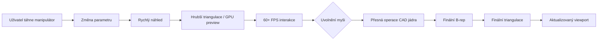
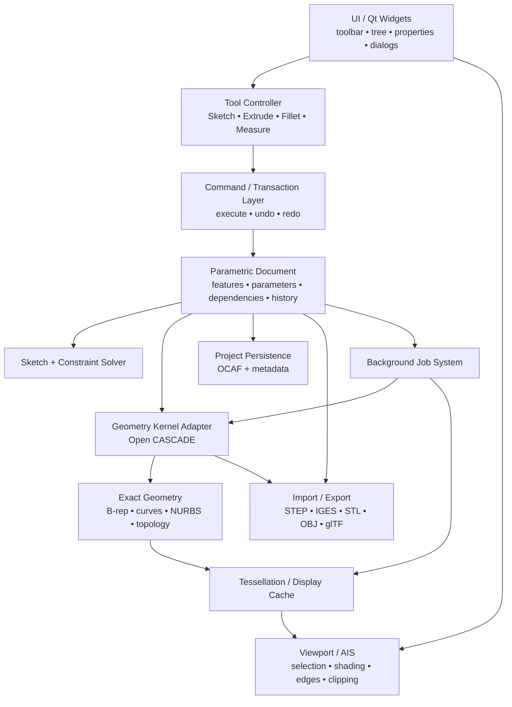
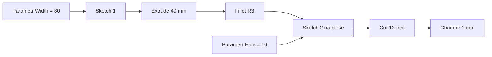
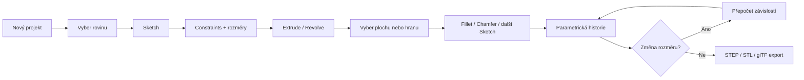
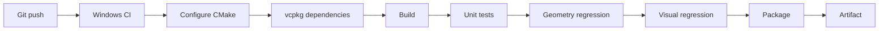
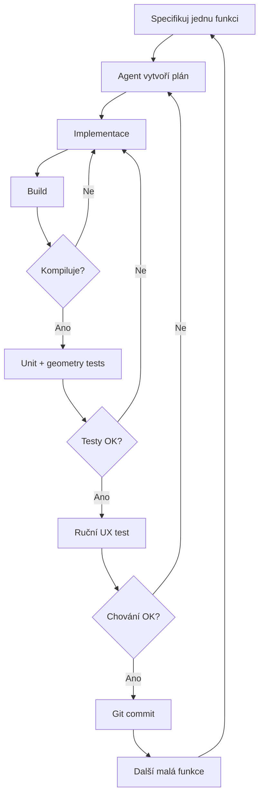

# Nativní Windows CAD pomocí vibecodingu: realistická cesta od prototypu k vlastnímu 3D modeláři

## Exekutivní shrnutí

**Ano, vytvořit vlastní nativní Windows aplikaci pro intuitivní 3D CAD pomocí vibecodingu je dnes reálně možné.** Zásadní ale je nezkoušet „naprogramovat CAD od nuly“. Je potřeba nechat hotové a velmi složité oblasti — přesnou geometrickou reprezentaci, booleovské operace, fillet/chamfer, import STEP, triangulaci a ideálně i výběr objektů ve 3D — na specializovaném CAD jádru. AI agent pak může stavět především **uživatelské rozhraní, příkazy, parametry, strom historie, manipulátory, ukládání projektu, testy a spojovací kód**.

Pro projekt jednoho člověka bych k 14. říjnu 2026 doporučil jako hlavní variantu:

> **C++20 + Qt Widgets + Open CASCADE Technology 8.x + OCCT AIS/Visualization + CMake + vcpkg + Visual Studio/Codex nebo GitHub Copilot Agent.**

Důvodem není to, že C++ je nejjednodušší jazyk. Není. Výhodou je, že **Open CASCADE i Qt jsou přirozeně C++ knihovny**, takže odpadne velká mezivrstva mezi GUI a CAD jádrem. OCCT je přímo platforma pro 3D CAD/CAM/CAE, obsahuje přesnou topologii a geometrii, modelovací algoritmy, datovou výměnu a vizualizaci. Je pod LGPL 2.1 se speciální výjimkou. Qt 6.12 je současná LTS řada a na Windows podporuje několik grafických backendů včetně Direct3D 11, Direct3D 12, Vulkanu a OpenGL. Pro člověka bez klasického programátorského zázemí existuje atraktivní alternativa:

> **C#/.NET + WPF nebo WinUI 3 pro celé GUI, samostatná C++ DLL s Open CASCADE pro CAD jádro.**

C# je pro vibecoding příjemnější, kód je obvykle čitelnější a práce s UI, commandy a datovým modelem bývá rychlejší. Microsoft dnes pro nové Windows aplikace doporučuje WinUI 3; WPF však zůstává velmi silným desktopovým frameworkem s XAML, data bindingem a vyzrálým ekosystémem. Cena za C# variantu je další **interop vrstva mezi .NET a C++**, která je u komplikovaných CAD dat nepříjemná.

**Nedoporučuji v první verzi psát vlastní DirectX 12 nebo Vulkan renderer.** Direct3D 12 přesouvá na aplikaci explicitní synchronizaci, správu životnosti GPU prostředků, residency, command lists a descriptors; Microsoft sám zdůrazňuje, že jde o výrazně nízkoúrovňovější model než Direct3D 11. Vulkan má podobně explicitní synchronizaci. Pro první CAD je mnohem cennější funkční picking hran, zvýraznění ploch, clipping a správná návaznost vizualizace na B-rep model než vytěžit posledních několik procent GPU výkonu.

**Pro MVP bych proto použil přímo vizualizační vrstvu Open CASCADE/AIS.** Vlastní renderer přes D3D11, bgfx nebo Vulkan bych přidal až tehdy, pokud se ukáže, že jej skutečně potřebuješ. OCCT dokonce obsahuje referenční Qt 3D viewer s CAD importem/exportem, takže tato kombinace není experimentální slepá ulička. Nejdůležitější koncepční rozhodnutí je oddělit:

**parametrický CAD model → přesné B-rep těleso → triangulaci → obraz na GPU.**

Triangulace, kterou vidíš na monitoru, nesmí být „zdrojem pravdy“. Zdroj pravdy je přesný CAD model. To umožňuje následné fillet, boolean, STEP export, parametrickou editaci a přepočítávání historie.

Realistický cíl pro jednoho vibecodera není konkurent SolidWorksu nebo Fusionu. Velmi dobrým cílem je **„osobní Shapr3D/Fusion-lite“**: sketch, constraints, extrude, revolve, boolean, fillet, chamfer, history tree, undo/redo, STEP/STL import/export, přesné měření, section view a příjemná manipulace ve viewportu. Siemens uvádí jako příklad Shapr3D, které pro své CAD jádro použilo Parasolid a pro sketcher D-Cubed právě proto, aby tým nemusel znovu implementovat základní geometrické technologie. Můj realistický odhad pro jednotlivce s intenzivní pomocí AI je přibližně **8–14 týdnů pro opravdu použitelný osobní MVP**, **4–8 měsíců pro solidní osobní CAD** a **rok až dva a více pro produkt, který začne připomínat komerčně robustní CAD**. Nejtěžší částí nebude kreslení oken, ale robustní parametrická historie, sketch constraints, topologické reference, chování při změně geometrie a tisíce okrajových případů.

## Vibecoding a volba technologického základu

### Co zde znamená vibecoding

Termín „vibecoding“ nemá jedinou přesnou technickou definici. Prakticky se používá ve dvou významech.

V původním, radikálnějším pojetí člověk především **popisuje AI, co chce vytvořit, nechává ji psát kód a jen omezeně kontroluje jeho vnitřnosti**. To se hodí na malé aplikace a experimenty, ale pro CAD je tento přístup příliš riskantní.

Druhou, podle mě mnohem užitečnější interpretací je **agentní vývoj řízený přirozeným jazykem**: člověk definuje architekturu a požadované chování, AI vyhledává soubory, implementuje změny, kompiluje projekt, spouští testy, opravuje chyby a člověk změny průběžně kontroluje. To už velmi přesně odpovídá dnešnímu Copilot Agent Mode. GitHub uvádí, že agent dokáže určit potřebné soubory, provést změny, navrhovat či spouštět příkazy terminálu a iterovat nad chybami; uživatel přitom změny kontroluje a příkazy jsou standardně schvalované. Microsoft popisuje totéž přímo ve Visual Studiu: agent zpracuje úlohu zadanou běžným jazykem, upravuje celý projekt a reaguje na výsledky kompilace a unit testů. **Pro CAD doporučuji právě druhý model: „AI píše většinu kódu, člověk vlastní architekturu a akceptační testy.“**

Na Windows dnes dávají smysl zejména:

**Visual Studio 2026 + GitHub Copilot Agent**, pokud chceš maximálně tradiční Windows/C++ prostředí; **Codex**, pokud chceš silně agentní způsob práce přes projekt a terminály; **Cursor/Windsurf** jako další agentní editory; a Git jako bezpečnostní síť. Aplikace Codex je od 4. března 2026 dostupná také pro Windows a je koncipována jako prostředí pro práci s více kódovacími agenty. Z hlediska vibecodingu je důležitější než „která AI je nejlepší“ vytvořit projektu **jasná pravidla**, například:

```text
- UI nesmí přímo používat OpenCASCADE.
- Veškeré CAD operace jdou přes GeometryService.
- Jedna uživatelská operace = jeden Command.
- Renderovací mesh není autoritativní geometrie.
- Každá nová modelovací funkce musí mít unit test.
- Veškerá geometrie interně používá milimetry.
- UI thread nikdy neprovádí STEP import ani těžký boolean.
- Po každé změně musí projít build + test suite.
```

Právě takové instrukce podstatně snižují tendenci AI vytvářet postupem času „špagetový“ projekt.

### Porovnání jazyků a GUI

| Stack | Silné stránky pro CAD | Slabiny | Vhodnost |
|---|---|---|---|
| **C++ + Qt Widgets** | Přímá integrace OCCT/CGAL; velmi dobré desktopové GUI, panely, tree views, property editory; multiplatformnost do budoucna | C++ je složitější, chyby paměti; delší kompilace | **★★★★★ moje první volba** |
| **C++ + WinUI 3** | Skutečně moderní Windows UI; nativní Windows API; C++ bez wrapperu kolem OCCT | CAD desktop UX je nutné skládat více ručně; větší závislost na Windows stacku | ★★★★ |
| **C# + WPF + C++ CAD DLL** | Velmi rychlé GUI, XAML/data binding, dobré pro vibecoding; vyzrálý desktop | Nutná .NET ↔ C++ mezivrstva | **★★★★½** |
| **C# + WinUI 3 + C++ CAD DLL** | Modernější vzhled než WPF; Microsoftem doporučená cesta pro nové Windows aplikace | Interop + WinUI; některé klasické desktopové CAD vzory jsou ve WPF/Qt jednodušší | ★★★★ |
| **Rust + windows-rs + C++ CAD DLL** | Výborná kontrola paměťové bezpečnosti na vlastní straně; přístup k Win32/WinRT | OCCT a většina tradičního CAD stacku je C++; FFI přidává složitost | ★★★ |
| **.NET MAUI** | Jedna aplikace pro Windows, macOS, Android, iOS; Windows backend používá WinUI 3 | Pro čistě Windows desktop CAD abstrakce navíc bez zásadního přínosu | ★★½ |
| **Čistý Win32/C++** | Maximální kontrola | Obrovské množství infrastruktury, kterou Qt/WinUI řeší | ★★ |

Microsoft dnes označuje WinUI 3 za doporučený nativní UI framework pro nové Windows desktopové aplikace; podporuje C# i C++. WPF je naproti tomu zavedené Windows/.NET GUI s XAML, data bindingem, vektorovým vykreslováním a hardwarovou akcelerací. .NET MAUI cílí kromě Windows také na Android, iOS a macOS a na Windows používá WinUI 3, takže jeho hlavní výhoda se projeví především tehdy, pokud skutečně plánuješ další platformy. Qt je pro CAD trochu zvláštní případ: není „Windows-only nativní UI technologie“, ale vytváří skutečnou desktopovou aplikaci a dlouhodobě patří k nejpraktičtějším C++ GUI frameworkům. Qt 6.12 má komerční i LGPLv3/GPLv3 možnosti; některé moduly jsou dostupné pouze pod GPL nebo komerční licencí, takže konkrétní moduly je vhodné zkontrolovat. ### Moje rozhodnutí pro tento konkrétní projekt

Kdybych projekt navrhoval pro tebe, nevolil bych technologii jen podle toho, v jakém jazyce AI generuje nejhezčí kód. Minimalizoval bych počet hranic mezi komponentami:

```text
Windows
   │
Qt Widgets
   │
C++ Application Layer
   │
OpenCASCADE
   ├── Modeling
   ├── B-rep / NURBS
   ├── STEP / IGES
   ├── Tessellation
   └── Visualization / AIS
```

To je pro první verzi výrazně jednodušší než:

```text
WinUI/C#
  │
.NET ViewModel
  │
P/Invoke / C++/CLI / C API wrapper
  │
C++ model
  │
OCCT
```

Druhou variantu bych zvolil pouze tehdy, pokud je pro tebe výrazně důležitější rychlost tvorby UI v C# než minimální technická složitost celého systému.

## Geometrické jádro, renderování a výměnné formáty

### Geometrické jádro je nejdůležitější rozhodnutí

CAD jádro řeší úplně jiný problém než 3D renderer.

Renderer potřebuje převážně trojúhelníky. CAD musí vědět například:

> „Toto je válcová plocha o poloměru 20 mm, tato hrana je průsečnice dvou přesných ploch, tato plocha je orientovaná součást uzavřeného solidu a tato křivka je NURBS.“

Právě díky tomu lze později provést přesný fillet, boolean nebo export do STEP.

### Porovnání hlavních jader

| Jádro / knihovna | B-rep / NURBS | Boolean | Fillet / chamfer | Meshing | STEP/IGES | Licence | Verdikt |
|---|---:|---:|---:|---:|---:|---|---|
| **Open CASCADE Technology** | Ano | Ano | Ano | Ano | Ano | LGPL 2.1 + výjimka | **Nejlepší poměr dostupnost/schopnosti** |
| **Parasolid** | Ano, špičkové | Ano | Ano | Ano | Přes Siemens ekosystém | Proprietární/komerční | **Technicky špičková varianta** |
| **CGAL** | Částečně; není klasické CAD jádro | Výborné zejména polygonální/exaktní operace | Ne jako kompletní CAD kernel | Výborné | Ne jako hlavní CAD exchange stack | GPL/LGPL dle balíku nebo commercial | Doplněk k CAD jádru |
| **libIGES** | Ne jako plné jádro | Ne | Ne | Ne | IGES | LGPL; stav projektu omezený | Importní knihovna, ne základ CADu |
| **Vlastní geometrie** | Musel bys napsat | Musel bys napsat | Velmi těžké | Musel bys napsat | Musel bys napsat | Tvoje | **Nedoporučeno** |

OCCT je otevřená C++ platforma pro 3D CAD/CAM/CAE a aktuální zdrojový strom je distribuován pod LGPL 2.1 se speciální Open CASCADE výjimkou. Jeho modelovací vrstva obsahuje B-rep topologii a modelovací algoritmy; dokumentace například poskytuje algoritmy pro sweep a fillet a rodina `BRepAlgoAPI` slouží pro booleovské operace. **CGAL bych nevnímal jako náhradu OCCT.** CGAL se samo charakterizuje jako knihovna efektivních a spolehlivých algoritmů výpočetní geometrie — triangulace, polygonální geometrie, meshing, convex hull, arrangementy apod. Je fantastické jako doplňková sada geometrických algoritmů, ale není to hotové strojírenské parametrické CAD jádro. Licencování závisí na použitém balíku: fundamentální části jsou často LGPL, mnoho vyšších algoritmů GPL; existuje komerční varianta. **Parasolid je technicky nejzajímavější komerční alternativa.** Aktuální Parasolid 39.0 podporuje B-rep, facetovou a implicitní geometrii v jednom modelu a Siemens v roce 2026 zdůrazňuje další rozvoj multithreadingu a Convergent Modeling. Jde o licencované proprietární jádro, které Siemens poskytuje jiným softwarovým výrobcům. Pro představu o jeho významu: Shapr3D zkombinovalo Parasolid s D-Cubed 2D constraint solverem. Pro **osobní vibecodingový CAD** bych však začal na OCCT. Parasolid bych zvažoval, až kdyby se ukázalo, že limitem projektu je skutečně geometrické jádro, nikoli vlastní aplikace.

### Sketch constraints nejsou totéž co CAD kernel

Open CASCADE vyřeší spoustu 3D geometrie, ale sketcher typu Fusion/SolidWorks má ještě samostatný **constraint solver**.

Například:

```text
bod A leží na přímce
délka = 35 mm
dvě čáry jsou kolmé
kružnice je tečná k čáře
dva oblouky mají stejný poloměr
bod je horizontálně s druhým bodem
```

To není pouhé „nakreslení čáry“. Solver musí dopočítat souřadnice všech prvků tak, aby současně splňovaly systém geometrických podmínek.

Existují možnosti jako SolveSpace solver, případně komerční D-Cubed 2D DCM. Siemens D-Cubed výslovně popisuje jako constraint technologii používanou pro 2D sketchery a 3D pozicování sestav. Pro MVP lze constraint solver zpočátku omezit na:

**coincident, horizontal, vertical, parallel, perpendicular, equal, distance, radius, angle, tangent a fix.**

To už umožní překvapivě schopný sketcher.

### Renderovací API

| API | Obtížnost | Výkonový potenciál | Platformy | Vhodnost pro tento CAD |
|---|---|---|---|---|
| **Direct3D 11** | nízká až střední | Velmi vysoký pro běžný CAD | Windows | **Výborná vlastní Windows varianta** |
| **Direct3D 12** | velmi vysoká | Výborný, zejména při extrémních scénách/CPU overheadu | Windows | Až pro pokročilou verzi |
| **OpenGL** | střední | Pro CAD dostatečný | Windows/Linux/macOS dle stacku | **Velmi praktický s OCCT** |
| **Vulkan** | velmi vysoká | Výborný | multiplatformní | Až při vlastním pokročilém rendereru |

Direct3D 12 není „lepší D3D11, který stačí zapnout“. Microsoft popisuje D3D12 jako zásadně odlišný, nižší level: synchronizaci, residency paměti, command lists, descriptors a životnost prostředků má více na starosti samotná aplikace. Odměnou je menší overhead a lepší využití moderního hardwaru. Vulkan funguje v podobném duchu; jeho specifikace uvádí, že synchronizace přístupu k prostředkům je primárně odpovědností aplikace. **Proto bych pro CAD MVP explicitní D3D12/Vulkan vynechal.**

CAD viewport obvykle potřebuje spíš:

- rychlou triangulaci po změně B-repu,
- selection/picking,
- pre-highlight,
- hrany nad shaded tělesem,
- section clipping,
- transparentnost,
- hidden-line režim,
- přesnou práci s kamerou,
- manipulátory,
- velké množství opakovaných objektů,

než efekty známé z moderních AAA her.

### Hotové renderovací vrstvy a enginy

**OCCT Visualization/AIS** je pro první verzi moje jasná volba, protože je spojena přímo s CAD topologií. U CADu je například zásadní, zda kliknutí vybralo celý `Solid`, konkrétní `Face`, `Edge` nebo `Vertex`; OCCT má pro selection vlastní filtry a kontext. **bgfx** je výborná mezivrstva, pokud bys později chtěl vlastní renderer bez přímého přivázání k jednomu API. Aktuálně podporuje na Windows mimo jiné Direct3D 11, Direct3D 12, OpenGL a Vulkan a používá BSD-2 licenci. **OGRE / OGRE-Next** je plnější C++ rendering engine a nabízí například Direct3D11 a Vulkan render systémy. Pro CAD bych ho ale volil pouze tehdy, pokud se aplikace začne posouvat od konstrukčního CADu směrem k pokročilé vizualizaci.

**Filament** je vhodný pro real-time fyzikálně založené materiály a fotorealističtější prezentaci. Je tedy zajímavý například jako druhý „presentation viewport“, ale nenahrazuje CADové služby jako topologický picking, B-rep ani parametrickou geometrii.

**three.js** bych do skutečně nativní desktopové architektury nezařazoval. Jeho přirozeným prostředím je JavaScript/WebGL a webový runtime. Pro rychlý webový prototyp by dával smysl, pro zde požadovanou nativní Windows aplikaci přináší zbytečnou webovou mezivrstvu.

### Real-time versus offline rendering

Pro modelování potřebuješ **real-time viewport**. Optimální workflow není během tažení myší pokaždé přepočítat všechno v maximální kvalitě.

Lepší je:



Offline/path-traced rendering je jiný produktový problém. Pro první vlastní CAD bych vůbec nepsal vlastní offline renderer: export glTF/OBJ do Blenderu nebo jiného rendereru je násobně efektivnější. glTF je přímo navržen jako efektivní runtime formát pro přenos a načítání 3D scén a podporuje PBR materiály. ### Datové formáty

| Formát | Typ dat | Co zachová | Ideální použití |
|---|---|---|---|
| **STEP** | přesný CAD/product model | B-rep, analytická geometrie a podle aplikačního profilu další produktová data | **Hlavní výměnný CAD formát** |
| **IGES** | starší neutrální CAD exchange | křivky, plochy a CAD geometrii | Kompatibilita se staršími systémy |
| **STL** | trojúhelníková síť | prakticky jen povrchovou mesh geometrii | 3D tisk |
| **OBJ** | polygonální model | mesh, normály, UV/material reference | obecná vizualizace |
| **glTF/GLB** | optimalizovaná runtime scéna | mesh, materiály, hierarchii, PBR atd. | realtime prezentace/web/AR |
| **Vlastní projekt** | parametrický dokument | sketches, constraints, feature history, parametry, metadata | **Editovatelný zdrojový dokument** |

STEP je součást rodiny ISO 10303 a je navržen pro výměnu reprezentace produktových dat, nikoli jen trojúhelníků. IGES je proti STEP historicky užší, více zaměřený na geometrickou výměnu. OCCT je v tomto směru mimořádně praktické: jeho ekosystém pracuje se STEP, IGES, glTF, OBJ a STL; CAD Assistant založený na OCCT tyto formáty používá i pro vzájemnou konverzi. Důležitá věc: **STL, OBJ ani glTF nesmí být interním projektovým formátem parametrického CADu.** Po exportu do triangulované sítě se ztratí například informace, že díra vznikla sketchem o průměru 10 mm a následným extrude-cut.

## Architektura aplikace a intuitivní CAD UX

### Doporučená modulární architektura

Největší ochrana před vibecodingovým chaosem je rozdělit aplikaci na jasné vrstvy.



Zde bych důsledně držel pravidlo:

> **UI nikdy nemanipuluje přímo s objekty OCCT.**

UI řekne například:

```text
CreateExtrude(
    sketchId = "Sketch17",
    distance = 42.0 mm,
    operation = Cut
)
```

A aplikační vrstva rozhodne, co se musí přepočítat.

To umožní později vyměnit GUI, renderer nebo dokonce geometrické jádro, aniž se musí přepsat celý program.

### Parametrická historie jako graf závislostí

Strom historie není jen seznam.

Příklad:



Když uživatel změní `Width` z 80 na 90 mm, musí aplikace zjistit:

```text
Sketch1
 ↓
Extrude
 ↓
Fillet
 ↓
Sketch2
 ↓
Cut
 ↓
Chamfer
```

a přepočítat pouze závislé uzly.

Praktická interní reprezentace může být například:

```text
Document
 ├── Parameters
 │    ├── Width = 80 mm
 │    └── Thickness = 4 mm
 │
 ├── Feature 001 : Sketch
 ├── Feature 002 : Extrude
 ├── Feature 003 : Fillet
 ├── Feature 004 : Sketch
 └── Feature 005 : Pocket
```

Každý `Feature` by měl mít:

- neměnné ID,
- typ operace,
- vstupní reference,
- parametrický payload,
- závislosti,
- stav výpočtu,
- diagnostiku chyby,
- výsledný shape,
- revision číslo.

### Undo/redo a persistence

Nedoporučuji implementovat undo stylem „před každým kliknutím zkopíruji celý model“.

Správnější je **Command + Transaction**:

```text
ExtrudeCommand
  oldDistance = 25
  newDistance = 40

execute()
undo()
redo()
```

Open CASCADE má navíc OCAF — Open CASCADE Application Framework — který obsahuje dokumentový model, persistence a infrastrukturu pro undo/redo. Dokumentace OCAF explicitně uvádí správu creation/storage/retrieval dokumentů a možnost implementovat undo/redo. To z OCAF činí mimořádně zajímavý základ pro **nativní projektový formát**. Nedržel bych ale projekt pouze jako „STEP plus JSON“, protože STEP neuchová tvoji aplikační historii ve smyslu, ve kterém ji potřebuje parametrický modelář.

Praktický formát vlastního projektu může být například ZIP kontejner:

```text
MyPart.jcad
 ├── document.xbf
 ├── project.json
 ├── preview.png
 ├── settings.json
 └── sources/
      └── imported-original.step
```

`project.json` by obsahoval vlastní verzi formátu, jednotky, metadata aplikace a případná data, která nejsou v OCAF.

### Nejtěžší problém: stabilní topologické reference

Představ si:

```text
Box
→ Fillet edge #7
→ Sketch on face #3
```

Potom uživatel změní délku boxu nebo před fillet vloží další operaci.

Je velmi nebezpečné předpokládat, že „face #3“ je stále stejná fyzická plocha. Po booleovské operaci nebo filletu se mohou plochy rozdělit, sloučit nebo přečíslovat.

To je známá třída problémů parametrických CADů. OCAF obsahuje persistence mechanismy a topologickou dokumentovou infrastrukturu, takže je výhodnější stavět na něm než vytvářet vlastní systém od úplné nuly. Pro MVP bych ale rozsah ještě zjednodušil: nejprve stabilní reference na **feature → shape/subshape**, a teprve později pokročilé přemapování reference při změně topologie.

### UX, které udělá z CADu „intuitivní CAD“

Technicky schopné jádro ještě nevytvoří příjemný modelář. U osobního CADu bych investoval překvapivě velkou část času právě do interakce.

Základní nástroje by měly být:

**Sketch → Extrude → Revolve → Boolean → Fillet → Chamfer**, následované Sweep a Loft. OCCT pro tento typ B-rep operací poskytuje příslušnou modelovací infrastrukturu včetně sweepů, booleovských operací a filletů. Skutečný rozdíl však udělají tyto mechanismy:

**Preselection.** Když kurzor přejede přes hranu, ta se ještě před kliknutím rozsvítí. Uživatel nikdy nemusí přemýšlet, co právě vybere.

**Selection filters.** Přepínače Body / Face / Edge / Vertex / Sketch. OCCT už obsahuje selection framework a filtry, což je další argument pro využití AIS místo okamžitého psaní vlastního rendereru. **Inference a snapping ve sketcheru.** Endpoint, midpoint, center, intersection, horizontal, vertical, tangent, perpendicular, grid.

**Přímé číselné zadávání.**

```text
[ táhnu extrude ]
        ↑
     37.4 mm
        │

napíšu:
50 Enter
```

**Manipulátory přímo v prostoru.**

Extrude = šipka.

Revolve = rotační prstenec.

Move = XYZ šipky + rovinné úchyty.

Fillet = drag radius.

**Dvě kvality preview.** Během drag operace má přednost odezva. Po puštění tlačítka myši proběhne přesný výpočet.

**Context toolbar.** Po výběru plochy není nutné hledat v menu:

```text
┌────────────────────────────┐
│ Extrude │ Offset │ Sketch │
└────────────────────────────┘
```

**History tree s chybovým stavem.**

```text
▼ Body 1
   ✓ Sketch 1
   ✓ Extrude 40 mm
   ✓ Fillet R3
   ⚠ Sketch 2
   ✕ Pocket
```

Po chybě zobrazit lidský důvod:

> „Pocket nelze přepočítat, protože referenční plocha po úpravě Fillet R3 již neexistuje.“

Ne jen:

```text
BRep_API: command not done
```

**Plynulá navigace viewportu.** Orbit, pan, zoom kolem bodu pod kurzorem, Fit All, Fit Selection, standardní pohledy, View Cube.

**Měření bez spuštění velkého nástroje.** Vyberu dvě plochy → vzdálenost. Dvě hrany → úhel. Kružnici → průměr.

**Section view.** Jedna nebo více clipping planes s okamžitým dragováním. U technického modelování je často užitečnější než fotorealistické materiály.

**Direct modeling** bych přidal až později: select face → push/pull, move face, offset face, delete/heal face. Je mimořádně příjemný, ale komplikuje vztah k parametrické historii.

Výsledný pracovní tok může být velmi jednoduchý:



## Vývoj, testování, výkon a bezpečnost

### Doporučený vývojový toolchain

Pro doporučenou C++ variantu bych použil:

```text
Visual Studio 2026
        +
CMake
        +
CMakePresets.json
        +
vcpkg manifest
        +
Git
        +
GitHub Actions
        +
GoogleTest
        +
AddressSanitizer
```

`vcpkg` v manifest režimu umožňuje definovat závislosti projektu v `vcpkg.json`; Microsoft jej doporučuje pro většinu nových vcpkg projektů a CMake integrace umí závislosti instalovat automaticky. Repozitář by mohl vypadat:

```text
jcad/
├── CMakeLists.txt
├── CMakePresets.json
├── vcpkg.json
│
├── src/
│   ├── app/
│   ├── ui/
│   ├── document/
│   ├── commands/
│   ├── geometry/
│   ├── sketch/
│   ├── rendering/
│   ├── io/
│   └── persistence/
│
├── tests/
│   ├── geometry/
│   ├── document/
│   ├── constraints/
│   ├── import_export/
│   └── golden/
│
└── samples/
    └── test_models/
```

### Testovat CAD jinak než běžnou aplikaci

Nestačí otestovat:

```text
Extrude() nevyhodil exception.
```

Je potřeba ověřovat geometrický výsledek.

Například:

```text
Box 10 × 20 × 30
volume = 6000 mm³
faces = 6

Cut cylinder Ø4
volume se zmenšil
solid zůstává validní

Fillet R2
výsledek je validní
```

Velmi užitečné jsou také **regresní CAD soubory**:

```text
tests/models/
 ├── boolean_001.step
 ├── broken_import_002.step
 ├── fillet_corner_003.step
 ├── tiny_edges_004.step
 └── nasty_nurbs_005.step
```

Každá chyba, kterou jednou objevíš, by ideálně dostala vlastní soubor a test. Tím vzniká postupem času ochranná síť, díky které AI neopraví jednu funkci tak, že rozbije tři jiné.

### Vizuální regresní testy

Viewport lze testovat tak, že se vytvoří deterministická scéna, pevná kamera a snímek se porovná s referenčním obrázkem.

```text
expected.png
      vs.
current.png
      ↓
pixel / perceptual difference
```

Tento způsob není hypotetický; například Filament má vlastní infrastrukturu `renderdiff` pro headless rendering a automatické porovnávání s „golden“ referenčními snímky. U různých GPU je vhodné nepoužívat absolutní shodu každého pixelu, ale toleranci.

### CI/CD

Při každém pushi:



Pro osobní nástroj úplně stačí jeden Windows x64 pipeline.

Na distribuci má Windows několik cest. Pro moderní zabalenou aplikaci je vhodný **MSIX**; u .NET/MAUI Microsoft podporuje MSIX i unpackaged variantu a CLI buildy pro CI. U Qt/C++ lze připravit adresář aplikace včetně potřebných DLL a následně vytvořit MSIX nebo tradiční instalátor.

### Multithreading

CAD aplikace by měla mít alespoň koncepčně tři světy:

```text
UI thread
   │
   ├── myš / klávesnice / panely
   └── nesmí zamrznout

Geometry workers
   │
   ├── STEP import
   ├── boolean
   ├── fillet
   └── tessellation

Render
   │
   └── GPU komunikace / frame
```

Typický tok:

```text
UI: "změnil jsem radius 5 → 8"
            ↓
cancel starého preview jobu
            ↓
worker: přepočítej feature
            ↓
worker: připrav tessellation
            ↓
UI/render: atomicky přijmi nový výsledek
```

Důležité pravidlo je **nepředpokládat automaticky, že libovolnou operaci CAD kernelu lze bezpečně spustit současně nad stejným dokumentem**. Paralelizovat je bezpečnější přes nezávislé úlohy a jasné vlastnictví dat. U Parasolidu Siemens například explicitně rozvíjí multithreaded execution a u některých rendering/faceting částí deklaruje thread-safe chování, což zároveň ukazuje, že thread safety geometrického kernelu je věc, kterou je nutné řešit vědomě. ### Paměť

Jeden model může existovat současně jako:

```text
Parametric feature model
+
B-rep
+
triangulation
+
GPU vertex/index buffers
+
undo data
+
temporary boolean data
```

Takže model, jehož výsledný STL má například 100 MB, může během práce spotřebovávat mnohonásobně více RAM.

Proto bych od začátku používal pouze **64bit build**, revision-based cache a explicitní zahazování neaktuálních triangulací.

Praktické pravidlo:

```text
Geometry revision 153
Mesh revision     153 → reuse

Geometry revision 154
Mesh revision     153 → invalid → rebuild
```

### GPU výkon

Nejúčinnější optimalizací není okamžitý přechod z D3D11 na D3D12.

Mnohem dříve se vyplatí:

- netriangulovat nezměněné objekty,
- neuploadovat stejné vertex buffery při každém snímku,
- snížit tessellation kvalitu během drag operace,
- používat instancing u opakujících se dílů,
- oddělit display mesh od přesného B-repu,
- zjednodušovat vzdálené objekty,
- nedělat exact boolean při každém pixelu pohybu myši.

Až profiler prokáže, že úzkým místem je skutečně CPU overhead renderovacích draw callů, začne dávat smysl uvažovat o D3D12/Vulkan. Direct3D 12 je navržen právě tak, aby redukoval část overheadu a umožnil lepší multithreaded přípravu command lists, ale za cenu větší odpovědnosti aplikace. Pro DirectX profilování je k dispozici PIX; jeho aktuální řada podporuje GPU/timing captures a pokračuje ve vývoji pro moderní D3D12. ### Bezpečnost

U osobní desktopové aplikace nejsou největším bezpečnostním problémem hackeři na síti, ale především **C++ chyby a nedůvěryhodné importované soubory**.

C++ může trpět use-after-free, double-free, buffer overflow a podobnými chybami; Microsoft Visual C++ obsahuje AddressSanitizer právě pro hledání těchto kategorií chyb. Zapnul bych ASan minimálně do pravidelné CI konfigurace.

Dále bych u STEP/STL/OBJ/glTF importu zavedl:

```text
max velikost vstupního souboru
max počet trianglů
max počet objektů
max hloubka hierarchie
timeout/cancel dlouhého importu
catch všech chyb kernelu
nikdy automaticky nepřepisovat původní soubor
```

A u AI agentů bych ponechal **schvalování destruktivních terminálových příkazů**. GitHub přímo doporučuje kontrolu změn a standardně vyžaduje schválení příkazů, pokud si uživatel automatické spouštění výslovně nenastaví. ## Realistický plán realizace a doporučené MVP

### Co bych považoval za minimální „plnohodnotný osobní CAD“

Ne „demo CAD“, kde lze vytvořit krychli, ale nástroj, ve kterém už skutečně něco navrhneš:

| Oblast | MVP | Později |
|---|---|---|
| Viewport | orbit/pan/zoom, Fit, standardní pohledy, selection | multi-viewport, render styles |
| Primitive | box, cylinder | cone, sphere atd. |
| Sketch | line, polyline, rectangle, circle, arc | spline |
| Constraints | coincident, H/V, distance, radius, perpendicular, parallel | tangent, symmetry, equations |
| Features | extrude, cut, revolve | sweep, loft, shell, draft |
| Modify | fillet, chamfer, boolean | direct face editing |
| Parametric | editable dimensions + feature history | expressions, configurations |
| Selection | body/face/edge/vertex | advanced filters |
| Analysis | measure | curvature, draft analysis |
| View | section plane | multiple sections |
| Data | STEP import/export, STL export | IGES, OBJ, glTF |
| Projekt | save/load, autosave | recovery versions |
| Editace | undo/redo | branching/history snapshots |
| Distribuce | lokální Windows build | signed installer/update |

### Etapy, které dávají smysl

#### Technický spike

**Můj odhad: 1–2 týdny intenzivní práce.**

Cíl:

```text
Qt okno
+
OCCT viewport
+
krychle
+
orbit/pan/zoom
+
kliknutí na plochu/hranu
+
STEP import
+
STL export
+
CMake build
```

Jestli se v této fázi nepodaří dosáhnout stabilního vieweru, nemá cenu začít programovat parametrickou historii.

Kombinace OCCT a Qt má výhodu, že Open CASCADE přímo poskytuje Qt 3D viewer sample s CAD import/export funkcemi. #### Modelovací jádro aplikace

**Přibližně další 2–4 týdny.**

Implementovat:

```text
Document
Feature
Command
Undo/Redo
Selection model
Extrude
Revolve
Boolean Cut/Fuse/Common
Fillet
Chamfer
```

V této fázi bych ještě neměl „krásný“ CAD. Cílem je ověřit architekturu.

#### Sketcher

**Přibližně 3–6 týdnů.**

To bude pravděpodobně první velká časová past.

Potřebuješ:

```text
2D pracovní rovinu
projekci kurzoru do roviny
line/circle/arc
snap
constraints
dimensions
solver
closed-wire detection
profile selection
```

Bez dobrého sketcheru sice máš geometrické jádro, ale ne intuitivní CAD.

#### Parametrická historie

**Přibližně 2–5 týdnů pro první použitelnou verzi**, poté dlouhodobé vylepšování.

Zde přichází:

```text
dependencies
dirty propagation
recompute
error states
stable IDs
suppression
feature editing
```

#### UX a každodenní použitelnost

**Dalších 4–8 týdnů**, často souběžně.

Právě zde se z technického experimentu stane nástroj:

```text
inline numeric input
snapping
context toolbar
pre-highlight
selection filters
view cube
section
measurement
autosave
recovery
keyboard shortcuts
manipulators
```

### Odhad celkové náročnosti

Toto jsou moje projekční odhady, nikoli čísla převzatá od výrobce některé knihovny.

| Výsledek | Intenzivní práce jednoho vibecodera s AI | Večer/víkendy |
|---|---:|---:|
| 3D technologické demo | 1–3 týdny | 1–2 měsíce |
| Základní modelář | 1–2 měsíce | 3–5 měsíců |
| **Použitelný osobní MVP CAD** | **2–3,5 měsíce** | **5–9 měsíců** |
| **Velmi dobrý osobní parametrický CAD** | **4–8 měsíců** | **9–18 měsíců** |
| Robustní produkt pro jiné uživatele | 12–24+ měsíců | několik let |

AI zde může dramaticky zrychlit boilerplate, GUI, testy, wrappery, build konfiguraci a standardní algoritmy. Neodstraní však inherentní komplikovanost geometrie. Fakt, že výrobci jako Shapr3D použili hotový Parasolid a D-Cubed, aby nemuseli tyto základní technologie znovu vytvářet, je velmi dobrá ilustrace tohoto rozdílu. ### Co bych naopak z první verze vědomě vyhodil

První verze by **neměla** obsahovat:

pokročilé sestavy, výkresovou dokumentaci, CAM, FEM, sheet metal, photorealistic rendering, vlastní D3D12 engine, plugin SDK, cloudovou synchronizaci, collaboration, macOS/Linux, vlastní STEP parser, vlastní B-rep kernel ani vlastní NURBS implementaci.

To nejsou „malé funkce navíc“. Každá z nich může být samostatný projekt.

### Doporučený cílový stack

Můj výsledný návrh bych tedy zmrazil takto:

```text
Jazyk:
    C++20/23

IDE:
    Visual Studio 2026

AI:
    Codex +/nebo GitHub Copilot Agent

GUI:
    Qt 6.12 LTS, primárně Qt Widgets

CAD kernel:
    Open CASCADE Technology 8.x

CAD document/persistence:
    OCAF/XCAF + vlastní feature model

Viewport:
    OCCT AIS / Visualization

Sketch:
    vlastní UI + existující constraint solver
    místo psaní solveru od nuly

Build:
    CMake + CMakePresets

Dependencies:
    vcpkg manifest mode

Tests:
    GoogleTest
    + CAD regression files
    + golden-image visual tests

Debug:
    Visual Studio
    AddressSanitizer
    případně RenderDoc/PIX podle rendereru

Import/export:
    STEP jako priorita
    STL export
    IGES až druhotně
    glTF/OBJ pro vizualizaci

Packaging:
    Windows x64
    MSIX nebo tradiční instalátor
```

OCCT pokrývá přesnou CAD geometrii, výměnné formáty a značnou část vizualizační infrastruktury; Qt řeší klasické desktopové GUI a C++ eliminuje jazykovou hranici mezi nimi. CMake s vcpkg pak poskytuje reprodukovatelnější správu sestavení a závislostí. ### Nejlepší strategie pro samotný vibecoding

Nezadával bych agentovi:

> „Vytvoř mi CAD podobný Fusion 360.“

To téměř jistě skončí působivým demem se špatnou vnitřní architekturou.

Pracoval bych v malých vertikálních řezech:



Jeden prompt tedy například:

> „Implementuj parametrický feature Extrude. Neměň UI ani renderer. Feature má odkazovat na uzavřený SketchProfile pomocí stabilního ID, mít parametr distance v mm a operation = NewBody/Add/Cut. Vytvoř unit test boxu 20×30×40, ověř objem a undo/redo. Build musí projít přes existující CMake preset.“

Pak teprve:

> „Připoj ExtrudeFeature do UI. Po výběru uzavřeného sketch profilu zobraz manipulátor, během tažení používej preview, po uvolnění myši commitni jeden Command.“

A teprve potom:

> „Přidej inline zadávání rozměru klávesnicí.“

Tento způsob využívá agentní nástroje přesně tam, kde jsou nejsilnější: mohou měnit více souborů, spouštět buildy a testy a iterovat podle chyb, zatímco člověk drží pevné hranice jednotlivých úloh. **Největší šanci na úspěch proto nevidím ve vytvoření „vlastního CAD enginu“, ale ve vytvoření vlastní jednoduché, velmi intuitivní CAD aplikace postavené nad profesionálním existujícím geometrickým enginem.** Pro tvoje vlastní použití je právě to velmi zajímavý vibecodingový projekt: technologicky je dnes dosažitelný, výsledek může být skutečně nativní a rychlý a rozsah lze držet pod kontrolou tím, že OCCT převezme matematicky nejtěžší část a ty se soustředíš na pracovní postup, který přesně vyhovuje tobě.