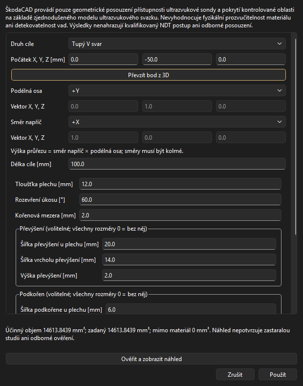
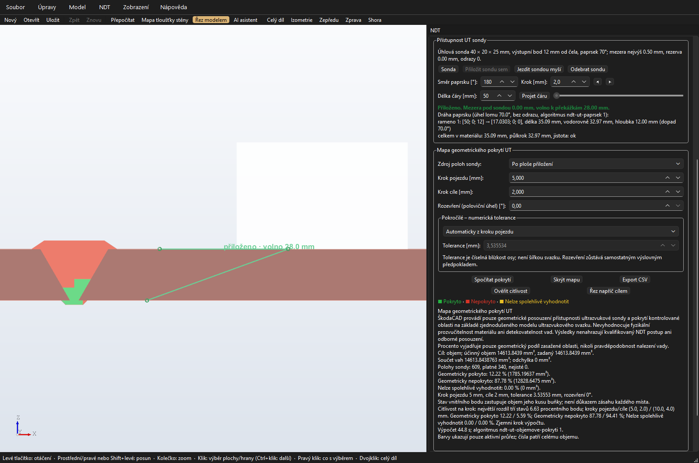
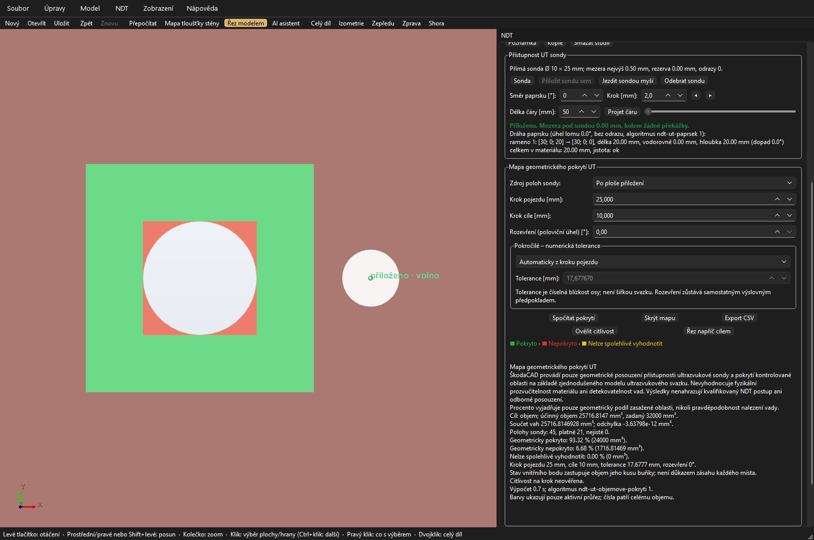

# NDT – návrh etapy 07C: ovládání cíle a barevné pokrytí v řezu

Stav: **implementace schválena autorem 17. 10. 2026 a připravena ve vývojové větvi;
probíhá ověření a příprava ke kontrole. Sloučení do `main` není schválené.**
Výchozí stav: `main`, commit `35f1507`, [sloučené PR #17](https://github.com/JendaNDT/SkodaCAD/pull/17).
Navazuje na [Etapu 07](12-navrh-etapa-07.md), [provedený krok 07B](13-navrh-etapa-07b.md)
a [závazné vymezení UT](04-zavazne-vymezeni-ut.md).

## Co půjde udělat běžným klikáním

Autor otevře ukázkový díl nebo vlastní model, zadá kontrolovaný objem či svar,
prohlédne jeho polohu, přiloží sondu a spočítá pokrytí. Ve stejném okně pak
posune řez a uvidí zelené, červené a žluté části **uvnitř zadané oblasti**.
Nebude potřebovat upravovat JSON nebo spouštět příkazy.

Souhrn bude stále ukazovat celý cílový objem v **mm³ a procentech**.
Řez slouží k prohlížení a celkové procento nemění. Zásah jednoho kontrolního
bodu zastupuje jeho objemový kus stejně jako v 07B; barevný průřez neznamená
vyšší přesnost výpočtu ani důkaz zásahu každého místa.

**První verze zobrazí barevné pokrytí objemu na ploše aktivního řezu.**
Bez řezu bude vidět neutrální náhled cíle a číselný souhrn s tlačítkem
**Řez napříč cílem**. Tento rozsah odpovídá objemové mapě v řezu z návrhu Etapy 07;
samostatné prohlížení všech barevných buněk v neprůhledném 3D tělese se nepřidává.

## 1. Rozsah a zachované vlastnosti

07A/07B již poskytují validaci cíle, skutečný objem, výpočet zásahů, CSV,
citlivost na krok a pomocný proces. 07C je zpřístupní v okně a doplní podklady
pro zobrazení. Nevytváří nový výpočet procent a nemění význam tří stavů.

- Podporované cíle: dosavadní plochy, rovný tupý V svar bez otupení, koutový
  svar a pomocný polygonální hranol. Jedna studie má jeden cíl.
- Obecný hranol znamená průnik s materiálem; nominální svar musí být celý
  v materiálu. Dva koutové svary zůstávají dvěma nezávislými studiemi.
- Formát modelu zůstává **16**, nové knihovny nejsou potřeba.
  Cíl se ukládá dosavadním způsobem, přiložení sondy, řez, rozpracovaný dialog,
  nastavení náhledu a výsledky pokrytí zůstávají pouze stavem otevřeného okna.
- Výrobní těleso, hmotnost a exporty STEP/STL se nemění.
- Automatické rozpoznání svaru, přilehlé oblasti podle normy, zakřivené svary,
  slučování výsledků studií a hledání nejlepší dráhy nejsou součástí tohoto kroku.

## 2. Ovládání v panelu NDT

Dosavadní zakládání studií z ploch zůstane použitelné. Přibude akce
**Nová objemová studie UT…** bez povinného výběru ploch a akce
**Cílová oblast…** pro úpravu cíle aktuální UT studie.
Dosavadní **Oblast z výběru** dál výslovně znamená povrchové plochy.

| Skupina | Co autor uvidí a provede |
|---|---|
| Cílová oblast | Druh, rozměry, poloha, zadaný a účinný objem; Upravit…, Ukázat cíl. |
| Přístupnost UT sondy | Dosavadní Sonda…, přiložení a pohyb, platnost přiložení a paprsek. |
| Mapa geometrického pokrytí UT | Samostatné kroky pojezdu a cíle, Spočítat pokrytí, Ověřit citlivost, Skrýt mapu a Export CSV…. |
| Pohled do objemu | Řez napříč cílem, přepnutí strany a posun řezu přes dosavadní panel Řez. |

Typ cíle bude pojmenovaný česky. Technické hodnoty `kind`, `frame`, otisky a
identifikátory procesů se v běžném ovládání nezobrazí. Při přepnutí studie se
ukáže její cíl; mapa jiné studie se skryje. Sonda a její dráha zůstanou viditelné
spolu s neutrálním obrysem objemu, i když běžné zvýraznění vybraných ploch potlačuje sondu.

## 3. Dialog „Cílová oblast UT“

Dialog otevře **kopii zadání**. Dokud autor nestiskne **Použít**, model ani
historie se nezmění. Zrušit zahodí návrh i dočasný náhled a vrátí původní pohled.
Použít je dostupné až po úspěšném ověření posledního zadání vůči aktuálnímu dílu.
Založení nové objemové studie i úprava existujícího cíle budou každý jeden krok Zpět.
Potvrzení shodného existujícího cíle je beze změny dokumentu a nepřidá prázdný krok historie.

### Základní údaje a poloha

- Druh: **Tupý V svar**, **Koutový svar**, **Kontrolovaný objem**;
  pro návrat k povrchovým plochám slouží výslovná akce Oblast z výběru.
- Počátek: X, Y, Z v mm a **Převzít bod z 3D** z posledního kliknutí na díl.
  Převzetí mění jen rozpracované zadání. Bod se neinterpretuje jako rozpoznaný svar.
- **Podélný směr** a **Směr napříč**: volby +X/−X/+Y/−Y/+Z/−Z;
  volba Vlastní směr rozbalí tři souřadnice vektoru. Směry musí být kolmé.
  Výška má směr `across × axis`; náhled ukáže tři šipky a počátek.
- Délka v mm. Směr a počátek jednoznačně určí, na kterou stranu objem pokračuje.
  Při otevření se nepřepočítá poloha podle „nejbližšího svaru“.

V dialogu bude jednoduchý **2D náhled průřezu s rozměry** a volba **Náhled v 3D**.
Základní směry dovolí zadat referenční díly bez psaní vektorů; vlastní orientace
zůstane dostupná pro obecný model. Jednoznačné směrové šipky mají přednost před
nejasným přepínačem „levý/pravý“, který by mohl převrátit i výšku průřezu.

### Rozměry podle druhu

| Druh | Pole a pravidla |
|---|---|
| Tupý V svar | Tloušťka, celkové rozevření úkosu [°], kořenová mezera. Volitelné převýšení a podkořen: výška, šířka u základny a šířka na konci, stejné jako v 07A. Nulová skupina znamená nepoužít; samotná neúplná skupina vyvolá chybu. |
| Koutový svar | Rameno napříč a rameno na výšku; trojúhelníkový průřez. Stranu určují souřadnice a šipky rámce. |
| Kontrolovaný objem – obdélník | Šířka, výška a délka; do modelu se uloží čtyři body dosavadního polygonu. |
| Kontrolovaný objem – polygon | Tabulka souřadnic napříč/výška v mm, Přidat bod a Odebrat bod, 3–256 vrcholů jednoduchého obrysu; poslední hranu program uzavře. Načtený konkávní polygon se zachová. |

Nejde o nový skicář s vazbami. Použijí se číselné rozměry z 07A, bez výrazů.
Vstup přijme desetinnou čárku i tečku. Otevření a potvrzení nezměněného cíle nesmí
zaokrouhlit načtené rozměry, polygon nebo normalizované směry na přesnost zobrazení.
Skrytá pole neaktivního typu se do cíle nepřidávají.

### Náhled, chyby a uložení

Náhled požaduje autor tlačítkem **Ověřit a zobrazit náhled**; u velkého dílu
neběží geometrické průniky při každém napsaném čísle. Změna hodnoty označí
poslední náhled za neaktuální a do jeho nového ověření vypne Použít.

- Účinný objem bude neutrálně modrý, s obrysem a možností jej skrýt.
  Není to zelený výsledek geometrického pokrytí.
- U obecného objemu se uvedou obě hodnoty: zadaný hranol a skutečný objem
  v materiálu. Část mimo materiál lze ukázat přerušovaným neutrálním obrysem.
- Neplatné zadání vypíše konkrétní český důvod u formuláře. Prázdný průnik a svar
  mimo materiál se nesmějí uložit jako platný cíl nebo ukázat jako hotové pokrytí.
- Zrušený nebo opožděný náhled nesmí přepsat novější zadání. Náhled sám nepotvrdí
  zastaralou studii a nezapíše odborné ověření.
- Použít provede jednu atomickou změnu přes ModelSession. Změna cíle zruší mapu
  a odborné ověření; Zpět/Znovu obnoví zadání podle dosavadních pravidel studie.
  Změna dílu mezi náhledem a potvrzením vynutí nové ověření, nikoli použití starého výsledku.

## 4. Výpočet a citlivost přímo v okně

Zpřístupní se objemové cíle tlačítku **Spočítat pokrytí** až po dokončení
zobrazení a jeho ověření. Pro platnou UT studii musí být přiložena její vlastní sonda.
Neplatné či zastaralé studie dostanou vysvětlení; pouhé zobrazení starého cíle
nezpřístupní výpočet. Rozměry, sklon, odrazy a dosah sondy dál patří do dialogu Sonda….
Omezení dosahu zde znamená **maximální celkovou dráhu osy v materiálu**, nikoli
fyzikální dosah přístroje. Tato volba v dosavadním dialogu chyběla a 07C ji doplňuje
jako nastavení otevřeného okna pro každou studii. Platí stejně pro kresbu, jemný
i hrubý běh; do JSON sondy se neukládá a po otevření modelu se nastavuje znovu.

- **Krok pojezdu [mm]** a **Krok cíle [mm]** samostatně; pro objem výchozí 5 a 2 mm.
  Vstup umožní například 1,25 mm a respektuje rozsah jádra 0,1–1 000 mm.
- Režim Po ploše přiložení / Z přímé dráhy; přímka s nulovým rozevřením se pro
  objem odmítne stejným vysvětlením jako v 07B. Rozevření se samo nezvětší.
- Rozbalovací **Podrobnosti výpočtu**: tolerance Automaticky / Ručně [mm]
  a dosavadní rozevření. U tolerance je vysvětlení „Numerické vyhledání osy;
  nevytváří šířku paprsku“. Automatika zachová přesně pravidlo 07B.
- **Ověřit citlivost** využije aktuální jemný výsledek a dopočítá hrubší běh.
  Pokud se změnily výpočetní volby, nabídne běžný nový výpočet; starý výsledek
  neoznačí za výsledek nových hodnot. V obou bězích zůstane stejná tolerance.

Souhrn uvede tři objemy a procenta, oba kroky a výsledek citlivosti:
**Neověřena**, **Rozdíl do 1 p. b. – pouze pozorovaná citlivost** nebo
**Výrazná citlivost – zjemni krok / zkontroluj nastavení**. Tato informace je
oddělená od žlutého stavu geometrických vzorků. Neověřená citlivost sama nemění
červené či zelené buňky na žluté.

Příklad 07B se zachová jako důkaz významu nastavení: u V svaru daly kroky 5/2
a 10/4 mm při automatické toleranci rozdíl 6,63 p. b. Doplňující kroky 5/1,25
a 10/2,5 mm s ruční tolerancí 8 mm daly 11,98/11,79 %, rozdíl 0,19 p. b.
Okno tyto hodnoty nebude doplňovat jako předem známou odpověď ani ručně zvýšenou
toleranci vydávat za automatické nastavení. Nižší rozdíl není zárukou přesnosti.

## 5. Jak bude fungovat barevný řez

**Řez napříč cílem** nastaví rovinu kolmou na podélnou osu v polovině délky cíle.
Přidá se pohledový režim řezu „Napříč cílem studie“; posuvník posouvá rovinu od
počátku do konce cíle v mm. Podporuje i natočený místní rámec. Otočit stranu
a dosavadní řezy X/Y/Z nebo rovnoběžně s rovinnou plochou zůstanou dostupné.
Režim cílového řezu se váže k vybrané studii; při jejím odstranění nebo neplatném
zadání se zruší s vysvětlením. Žádná tato nastavení se nepřidávají do JSON modelu.

Barevné plošky vzniknou z **průniku roviny se skutečnými oříznutými kusy buněk**,
ke kterým patří stavy 07B. Nevyplní se celé ohraničující kvádry.
Otvory, konkávní části a více oddělených kusů zůstanou rozlišené.
V řezu mohou být vedle sebe tři barvy; uzly různých stavů se nesdílejí a barvy
se na hranici neprolínají. Plocha bez výsledku nezíská zelenou výplň.

První verze bude zobrazovat barevné průřezy a neutrální obrys cíle ve 3D.
Díl zůstane viditelný jako kontext. Barevné překrytí nesmí zakrýt sondu,
její paprsek a měření ani se stát volitelnou konstrukční plochou modelu.
Změna čistě grafického zvýraznění nesmí přepsat výsledek.

Při řezu mimo cíl se zobrazí **Řez cílový objem neprotíná**; globální souhrn
a CSV zůstávají platné. Při vypnutí řezu zmizí barevná řezová plocha a zůstane
neutrální cíl s nabídkou zapnout řez. Ve výstupu nebude nové procento „pokrytí řezu“.

Přesná rovina na hranici buněk musí mít jednoznačného vlastníka výplně na ponechané
straně. Nesmějí se překrývat opačně obarvené shodné plošky. Čistý dotyk hranou
nevytvoří vyplněnou plochu. Kreslicí posun proti blikání překrytých ploch se řeší
jen v prohlížeči, nikdy posunutím výpočetního řezu nebo souřadnic exportu.

## 6. Technické provedení a hranice mezi oknem a jádrem

### Současná omezení

- `visible_ndt_coverage` u objemu záměrně vrací prázdnou kresbu.
  `VolumeSample` má bod, váhu a meze buňky, ale ne geometrii jejího kusu.
- `section.clip_mesh` umí oříznout povrchové trojúhelníky; **nevytvoří novou
  vyplněnou řezovou plochu**. Jeho samotné zapnutí objemovou mapu nevyřeší.
- `_refresh_coverage` dnes sleduje identitu výsledku. Pro nový náhled musí
  sledovat také rovinu řezu a verzi kresby, aby po posunu nezůstala stará plocha.
- Pomocné procesy se střídají a při zastavení zanikají. Uložení kusů jen do
  posledního procesu by proto nebylo spolehlivou mezipamětí pro další řez.

### Navržená rozhraní a přenos dat

Nový `gui/ndt_target_dialog.py` bude pouze formulář a 2D náhled nad daty.
Geometrii, historii a úlohy bude obsluhovat ModelSession; `gui/viewer.py`
pouze kreslí dodané sítě a obrysy. Nový modul `ndt/volume_display.py` připraví
neutrální náhled a barevné řezové sítě v pomocném procesu.

1. Nové úlohy `target_preview` a `volume_view` doplní dosavadní `coverage`.
   Náhled nese identifikátor rozpracovaného zadání a otisk aktuálního dílu.
   Závěrečné ověření před Použít také proběhne na pozadí; ModelSession použije
   jen shodný dokončený návrh a atomicky založí/upraví studii. Nesmí se při
   kliknutí Použít potichu opakovat drahé geometrické operace v hlavním vlákně.
   Dosavadní větev výpočtu dostane také volbu ověřit citlivost s předaným aktuálním
   jemným výsledkem. Hrubší běh slouží jen k porovnání a nesmí nahradit jemnou mapu
   nebo její zobrazovací podklady.
2. Při GUI výpočtu se volitelně zachytí skutečné kusy v okamžiku jejich vzniku
   ve vzorkování 07B. Soukromý zobrazovací podklad obsahuje binární zápis kusu
   přes stávající BinTools, jeho meze a vazbu na konkrétní vzorek/stav.
   `VolumeCoverageMap` dál nese číselný výsledek; podklad není součástí modelu ani CSV.
3. Podklad zůstane jako **bajty v soukromé mezipaměti ModelSession**. Živé OCCT
   objekty se nepicklují a GUI je nedekóduje. Příští úloha řezu jej může dostat
   v libovolném pomocném procesu, bez závislosti na jeho předchozím obsahu.
   CLI bez požadavku na kreslení žádná tělesa kusů navíc nepřenáší.
4. Při změně řezu se podle mezí vyberou relevantní kusy. Pomocný proces vytvoří
   jejich skutečné řezové plochy s otvory a rozloží je na trojúhelníky.
   Neprovádí znovu výpočet paprsků nebo procent a nespojuje stavy podle
   náhodného pořadí nově vytvořených těles. Vazba na původní vzorek musí zůstat přesná.
5. Do prohlížeče se vracejí jen souřadnice, trojúhelníky, barvy, obrysy a stav
   požadavku. Otisky dílu/cíle, identita mapy a rovina musejí odpovídat aktuálnímu
   pohledu. Opožděná odpověď se zahodí. Při čekání se starý barevný řez skryje,
   aby nebyl přiložen na novou rovinu.

Jde o rozšíření interního přenosu a mezipaměti, **nikoli změnu formátu JSON 16**.
Nová veřejná rozhraní ModelSession mají oddělit náhled návrhu, jeho potvrzení,
výpočet mapy a přípravu kresby. Stávající plošné/bodové API a výchozí číselné
výstupy 07B musejí zůstat kompatibilní.

### Rychlost, zastavení a chyby kreslení

Řez se stejně jako dnes zadává při puštění posuvníku nebo potvrzení hodnoty.
Příprava nové kresby běží na pozadí a jde zastavit. Není slibována plynulá
geometrická animace při každém pohybu myši.

Předběžné ochrany: limity buněk/kusů z 07B, nejvýše **500 000 trojúhelníků**
jedné kresby a **128 MiB** serializovaných podkladů a výsledné kresby dohromady.
Před přenosem se objem dat ověří. Místní geometrická paměť a skutečný čas se
navíc změří na referenčních modelech; tyto limity nejsou příslibem paměťové spotřeby OCCT.
Jemnost zobrazení bude oddělená od kroků výpočtu, nejvýše
`min(0,1 mm; krok cíle / 10)` jako lineární odchylka síťování.

Chyba nebo překročení limitu kreslení zachová již hotový číselný výsledek a CSV,
ale vypne neúplnou barevnou kresbu a jasně vysvětlí problém. Část mapy se nesmí
potichu vynechat nebo nahradit plnými kvádry. Ztráta zobrazovací mezipaměti nabídne
obnovení výpočtem mapy. Program sám nezmění krok nebo rozevření kvůli získání náhledu.

Při nové studii/modelu, změně cíle či sondy se zruší příslušné úlohy, podklady
i staré mapy. Pouhé přepínání řezu, skrytí náhledu a export nic v dokumentu nezmění.
Při souběhu požadavků má novější požadavek přednost; zastavení náhledu nesmí
poškodit uložený model nebo vrátit rozpracovaný formulář do jiné verze.

## 7. Povinné popisy výsledku

Název sekce zůstává **Mapa geometrického pokrytí UT**. Panel, dialog cíle,
číselný výstup a protokol/snímek s interpretací výsledku obsahují celé aktuální
`UT_DISCLAIMER`. Mapa i souhrn obsahují význam procenta a informaci o aproximaci buňkami.
Výsledek je vždy objemový v mm³; plochové studie nadále používají mm².

> ŠkodaCAD provádí pouze geometrické posouzení přístupnosti ultrazvukové sondy a pokrytí kontrolované oblasti na základě zjednodušeného modelu ultrazvukového svazku. Nevyhodnocuje fyzikální prozvučitelnost materiálu ani detekovatelnost vad. Výsledky nenahrazují kvalifikovaný NDT postup ani odborné posouzení.

> Procento vyjadřuje pouze geometrický podíl zasažené oblasti, nikoli pravděpodobnost nalezení vady.

Samostatný export nového obrázkového/PDF protokolu není součástí 07C. Pro předání
se pořídí skutečný snímek okna s viditelným souhrnem a legendou; CSV zůstává výstupem 07B.

## 8. Ověření a praktické předvedení

Následují podmínky implementace. Automatické a místní vývojářské zkoušky
nenahrazují autorovu ruční zkoušku ani odborné ověření NDT.

| Oblast | Co musí být ověřeno |
|---|---|
| Formulář | Založit a upravit každý typ cíle klikáním; desetinná čárka, polygon a vlastní rámec. Nezměněná načtená data se nezaokrouhlí. |
| Náhled | Správné rozměry a směry, odlišení zadaného a účinného objemu, neplatný svar nelze potvrdit. Náhled ani Zrušit nemění dokument nebo historii. |
| Historie | Použít = jeden krok Zpět, včetně nové studie. Zpět/Znovu, duplikace a uložení/načtení zachovají cíl a dosavadní pravidla ověření. |
| Zastaralá studie | Kontrola starého cíle jej sama nepotvrdí. Úprava dílu mezi náhledem a Použít odmítne starý návrh. |
| Číselný výpočet | Okno a API 07B mají stejné vzorky, váhy a stavy při shodném nastavení; 6 000 mm³ hranol, 2 450 mm³ koutový svar a 14 613,843876 mm³ V svar. |
| Citlivost | Stejná tolerance v obou bězích, maximum ze tří stavů; reprodukovat nestabilní i doplňující porovnání z 07B a uvést příslušné nastavení. |
| Skutečný řez | Analytická plocha průřezu hranolu odpovídá zobrazené síti. Změna polohy a otočení řezu nemění globální mm³ ani procenta. |
| Otvory a konkávní kusy | Otvor není vyplněný, kusy se nespojí přes vzduch. Test více kusů v jedné buňce, natočeného cíle a šikmého řezu. |
| Hranice buněk | Při přesné shodě roviny s hranicí není dvojí výplň, blikání ani barva z odříznuté strany; dotyk hranou nevytvoří plochu. |
| Tři barvy | Průřezy přebírají stav svých vzorků; mezi stavy nevzniká interpolovaná čtvrtá barva. Neurčený vnitřní bod zůstane žlutý. |
| Procesy a limity | Náhled, výpočet, nový řez, Zastavit, pád či vystřídání procesu a opožděná odpověď. Nikdy stará kresba na nové rovině, nikdy poškození modelu. |
| Chyba zobrazení | Číselný výsledek a úplné CSV zůstávají dostupné; neúplná mapa se netváří jako hotová. |
| Dosavadní funkce | Plošné pokrytí, měření, mapa tloušťky, výběr skutečných ploch a sonda fungují i po přepnutí studie, skrytí mapy a vypnutí řezu. |

Před předáním: kontrola `ruff check src tests`, celá sada `pytest -q`,
offscreen zkoušky skutečně stisknutých nových akcí s nahrazenými dialogy,
potom skutečné 3D okno se snímkem. Sestavení a self-test staženého balíčku
na Windows i macOS musí nově ověřit také objemový náhled a barevný průřez.
Automatická zkouška není ruční test na autorově MacBooku ani odborná validace NDT.

Předvedení autorovi bez příkazů:

1. Otevřít `tupy_svar_objem.json`, zobrazit a upravit cíl, ukázat jeho průřez
   a ověřený objem 14 613,843876 mm³; Zrušit musí původní cíl zachovat.
2. Nastavit přímý příčný řez v polovině délky, přiložit sondu shora na pravé straně,
   zadat parametry ukázky 07B, spočítat mapu a ověřit citlivost.
3. Prohlédnout barvy v několika řezech, otočit stranu a ověřit neměnný globální souhrn.
4. Exportovat CSV. Změnit cílovou oblast: stará mapa zmizí a odborné ověření neplatí.
5. Na koutovém svaru ukázat oddělené studie po 2 450 mm³; na pomocném objemu otvor
   a platné oříznutí materiálem. K předání přiložit snímek, souhrn nastavení a časy.

## 9. Malé kroky po schválení

| Krok | Výstup |
|---|---|
| **07C.1 – editor a neutrální náhled** | Dialog cíle, validace na pozadí, atomická historie, náhled rámce a účinného objemu. |
| **07C.2 – skutečné barevné průřezy** | Zobrazovací podklady, úloha řezu, diskrétní barvy, cílový řez, ochrana proti starým odpovědím a limity. |
| **07C.3 – ovládání výpočtu a předání** | Objemové výpočty a citlivost v panelu, správný souhrn/CSV, úplné testy, snímky a balíčky Windows/macOS. |

**Ke schválení je pouze implementace 07C v uvedeném rozsahu:** editor současných
cílů, neutrální náhled, barevné průřezy skutečných kusů, ovládání výpočtu a citlivosti
v okně, interní zobrazovací podklady a úlohy na pozadí. Bez nových knihoven a změny JSON 16.
Autor následně schválil implementaci 07C; sloučení do `main` vyžaduje další pokyn.

## 10. Provedení a místní ověření, 17. 10. 2026

Ve vývojové větvi `codex/ndt-etapa-07c` je editor všech tří druhů cíle, ověřovaný
neutrální náhled, atomické přijetí jako jeden krok Zpět, skutečné průřezy a panel
objemového výpočtu/citlivosti. Změna polohy řezu nemění váhy ani globální procenta.
Při výběru jiné studie se cizí mapa skryje. Výrobní těleso ani JSON 16 se nemění.

`volume_display.py` ukládá původní kusy do soukromých přenosných bytes;
`presentation.py` připravuje náhledy a průřezy v pomocném procesu. Před přenosem
nového řezu se číselnými mezemi vyberou relevantní kusy. Přesný průnik poloprostorem
zachovává díry a konkávní části. Na hranici buněk vlastní plochu ponechaná strana.
Kresba používá oddělené uzly stavů a odsun v kreslení, nikoli posun souřadnic.
Limity kresby a pád/zastavení procesu ponechají číselný výsledek a CSV.

Místní automatické a vývojářské zkoušky:

- `ruff check src tests` a celá sada **835 testů**. Nové zkoušky zahrnují vlastní
  rámec, čárku/tečku, zachování přesných čísel, neplatný svar, Zrušit, beze změny,
  jeden krok Zpět, zastaralou studii a odmítnutí náhledu jiného dokumentu.
- Volitelná maximální dráha osy v dialogu Sonda: geometrická kresba, jemný i hrubý
  běh používají stejné omezení, při změně se stará mapa zruší. Samotné omezení je
  pohled, bez nového pole v JSON; zkouška analyticky odlišuje 500 a 1 000 mm³.
- Analytická plocha hranolu a šikmého řezu, kruhová díra, konkávní průřez,
  dva kusy v jedné buňce, natočený rámec, tečný dotyk a vlastnictví přesné hranice.
- Skutečné střídání pomocných procesů, pád, zrušení, pozdní odpověď a limity;
  kresba nesmí ztratit numerická data. Zachycení zdroje nemění vzorky, zásahy ani váhy.
- Skutečné nativní 3D okno Windows: editor/náhled/Zrušit, barevný průřez,
  posuny a otočení řezu, CSV a zánik mapy po změně cíle. Celý self-test skončil **OK**.
  Self-test aplikace byl rozšířen i o přenos náhledu a průřezu pomocnými procesy;
  stejné zkoušky se spouštějí také ze stažených balíčků v CI.

### Reprodukce V svaru

Sonda shora v `[50, 0, 12]`, směr 180°, β 70°, bez odrazů, bez rozevření, pojezd
po pravé horní ploše. Výsledky odpovídají 07B; čísla nejsou vložená do implementace.

| Nastavení pojezdu/cíle | Pevná tolerance obou běhů | Jemný / hrubý běh: pokryto | Maximum rozdílu tří stavů |
|---|---|---|---|
| 5/2 proti 10/4 mm | automatická z jemného běhu: 3,535534 mm | 12,22 / 5,59 % | 6,63 p. b. – zjemnit krok |
| 5/1,25 proti 10/2,5 mm | ručně 8 mm | 11,98 / 11,79 % | 0,19 p. b. – nízká pozorovaná citlivost |

Celý účinný objem i součet vah jsou **14 613,843876 mm³**. Střední průřez má
**146,138439 mm²**; posuny na 25 a 75 mm ani otočení strany globální mapu nemění.
Nízká pozorovaná citlivost není zárukou přesnosti. Numerická tolerance není šířka svazku.

Místní měření Windows (orientační, nikoli příslib výkonu):

| Krok cíle | Kusů | Výpočet se zachycením zdroje | Dodatečný hrubý běh | Zdroj BinTools | Střední řez |
|---|---:|---:|---:|---:|---:|
| 2 mm | 2 700 | 43–45 s | přibližně 7 s | 13,68 MiB | 114 trojúhelníků, 0,08–0,09 s |
| 1,25 mm | 9 280 | přibližně 150 s | přibližně 21 s | 45,84 MiB | 240 trojúhelníků, 0,18 s |

Operační systém při jemnějším běhu zaznamenal špičku přibližně 745 MiB pro okno,
537 MiB a 379 MiB pro oba pomocné procesy (špičky nejsou nutně současné).
To zahrnuje Python, Qt a OCCT; limit 128 MiB přenosných dat není limitem celkové paměti.
Uvedené časy průřezu jsou časy geometrie v procesu; přenos a obnovení okna jsou navíc.

Další skutečné ukázky: pravý i levý koutový svar mají nezávisle **2 450 mm³**
a průřez **24,5 mm²**. Pomocný hranol 40 × 40 × 20 mm přes otvor Ø 20 má zadaných
32 000 mm³, účinných **25 716,814693 mm³**, vodorovný průřez **1 285,840735 mm²**;
otvor zůstává bez barevné výplně.

### Snímky skutečného okna

Sestavení a self-test stažených balíčků Windows/macOS se ověřují na konkrétním
commitu návrhu ke kontrole; konečný stav bude uveden přímo v PR. Tato dokumentace
netvrdí ruční zkoušku na autorově MacBooku ani odborné schválení NDT postupu.
