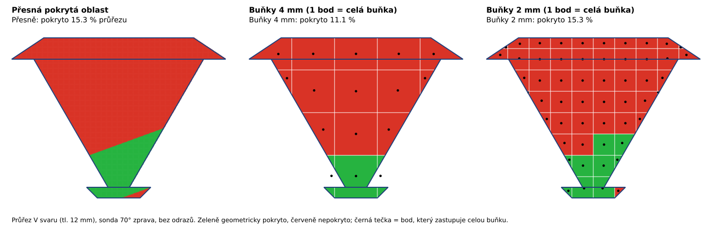

# NDT – rozbor: proč je objemové pokrytí V svaru citlivé na krok

Stav: **rozbor 17. 10. 2026; autor schválil opravy 1–3 z oddílu 6 („schvaluji opravy 1–3
z rozboru“) a jsou provedené ve vývojové větvi – viz [oddíl 7](#7-provedení-oprav).
Formát se nemění.**
Navazuje na [07B](13-navrh-etapa-07b.md) (výpočet a pravidlo porovnání kroků) a
[07C](14-navrh-etapa-07c.md) (výchozí kroky v okně). Závazné vymezení UT platí beze změny:
jde jen o geometrické pokrytí, procento není pravděpodobnost nalezení vady.

## Shrnutí

Úloha: `examples/ndt/cilove_objemy/tupy_svar_objem.json` – V svar v plechu 12 mm, úhlová
sonda 40 × 20 × 25 mm s paprskem 70°, bez odrazů, pojezd po pravé horní ploše, směr 180°.

- **Správná hodnota je 12,2 %** (12,15–12,29 % podle toho, kde přesně začíná platné
  přiložení sondy). Spočítaná nezávisle na mřížce – oddíl 1.
- Jemný výpočet 5/2 mm (12,22 %) byl **správně**. Hlášenou citlivost (6,63 p. b. u 5/2 mm,
  3,88 p. b. u 5/4 mm) způsobily dvě různé věci:
  - **A – chyba porovnávacího běhu:** hrubý běh hledá paprsky se stejně malou tolerancí
    jako jemný běh, ačkoli má dvakrát řidší mřížku poloh sondy. Část pokrytých míst proto
    vůbec nenajde. Není to vlastnost geometrie, ale nespravedlivé porovnání.
  - **B – skutečná chyba velkých buněk:** pokrytá oblast je malý klín u kořene
    (15 % průřezu). Buňka 4 mm je skoro stejně velká jako ten klín, takže výsledek
    rozhoduje to, kam padne jeden bod zastupující celou buňku.
- Výchozí kroky 07C (pojezd 5 mm, cíl 4 mm) dávají **9,02 % – o 3,2 p. b. méně** než
  skutečnost. Varování „zjemni krok“ v okně bylo tedy oprávněné, jen jeho velikost
  zkreslovala příčina A.

## 1. Referenční hodnota nezávislá na mřížce

Paprsek leží v rovině XZ (směr 180°), úloha se proto podél svaru nemění. Pokrytí stačí
zjistit v průřezu a vynásobit délkou, na které se sonda vejde.

- **Platné přiložení:** výstupní bod x0 od **22,0 mm** do 122,0 mm (krok zkoušky 0,1 mm),
  v Y od −40 do +40 mm. Blíž ke svaru čelo sondy (12 mm před výstupním bodem) narazí
  na převýšení, které končí v x = 10 mm. Z délky svaru 100 mm je tedy dostupných 80 mm.
- **Bodová zkouška:** body průřezu po 0,25 mm (2 336 bodů = 146,00 mm²). Pro každý bod se
  spočítá, kde osa paprsku přes něj vystupuje z horní plochy, sonda se tam skutečně
  přiloží (`devices.place`) a první rameno se trasuje (`ut.trace_beam`) – stejné funkce
  jako výpočet 07B, jen bez mřížky poloh a bez buněk. Výsledek: **22,31 mm² = 15,28 %**
  průřezu.
- **Výpočet plochy vzorcem:** průřez oříznutý přímkou x + 2,7475 · (12 − z) ≥ x0,min
  (2,7475 = tg 70°) a u podkořene podmínkou, že dráha projde rovinou z = 0 uvnitř jeho
  šířky ±3 mm. Pro x0,min = 21,9 … 22,0 mm vychází **15,18–15,36 %** průřezu.
- Objem: 15,2–15,4 % × 80/100 = **12,15–12,29 %**; bodová zkouška dává 12,23 %.

## 2. Pokusy (cloudový počítač, stejná úloha)

| Pojezd [mm] | Buňka cíle [mm] | Tolerance hledání [mm] | Pokryto | Poznámka |
|---|---|---|---|---|
| 5 | 2 | 3,54 (automaticky) | **12,22 %** | jemný běh 07B – správně |
| 10 | 2 | 3,54 (převzatá) | 8,22 % | **A:** porovnávací běh nenajde část paprsků |
| 10 | 2 | 7,07 (= 10 × √0,5) | **12,22 %** | stejné jako pojezd 5 mm |
| 5 | 4 | 3,54 (automaticky) | 9,02 % | **B:** výchozí kroky 07C – buňky moc velké |
| 10 | 4 | 7,07 | 9,02 % | pojezd sám výsledek nemění |
| 10 | 4 | 3,54 (převzatá) | 5,59 % | A + B dohromady (porovnání v 07B) |
| 5 | 8 | 3,54 | 21,50 % | B: velká buňka tentokrát nadsadí |
| 10 | 8 | 3,54 (převzatá) | 12,90 % | porovnávací běh k 5/4 – náhodou „blízko“ |
| 5 | 2,5 | 3,54 (automaticky) | 11,79 % | navržený výchozí krok cíle (oddíl 6), 67 s |
| 5 | 1,25 | 3,54 | 11,98 % | z 07B |

Doba jemného běhu na cloudovém počítači: buňka 4 mm 36 s, 2,5 mm 67 s, 2 mm 105 s.

## 3. Příčina A – porovnávací běh hledá s příliš malou tolerancí

Na **rovinné** pojezdové ploše program každé místo, které leží blízko některé osy paprsku,
znovu **přesně ověří**: dopočítá polohu sondy, ve které osa místem projde, sondu tam skutečně
přiloží (otisk, kolize, rezerva) a paprsek znovu trasuje (`coverage._resolve_axis_hit`).
Tolerance proto neznamená šířku svazku – je to jen **poloměr hledání**: jak daleko od os
z mřížky poloh se program podívá. Větší tolerance na rovině nikdy nevyrobí falešné
„pokryto“ (na zakřivené ploše jen „nelze spolehlivě vyhodnotit“).

Osa paprsku se při směru 180° v Y nehýbe. Mřížka poloh 10 mm má tedy osy po 10 mm v Y,
ale hledá se jen 3,54 mm daleko – místa mezi nimi zůstanou „nenalezená“, a tedy nepokrytá.
Pravidlo 07B §6 („tolerance se převezme z jemnějšího běhu“) mělo zajistit stejné fyzikální
předpoklady, ale tolerance na rovině fyzikální předpoklad není. Proto vyšlo 12,22 % → 8,22 %
při stejných buňkách. S tolerancí 7,07 mm dává hrubý pojezd přesně totéž co jemný.

## 4. Příčina B – pokrytá oblast je malý klín u kořene

Sonda 70° z pravé strany zasáhne jen spodní část úkosu: místa nad šikmou čarou mají výstup
paprsku blíž než 22 mm od středu svaru, kde sonda naráží na převýšení. Pokrytý klín má
v průřezu 22 mm²; jedna buňka 4 × 4 mm má 16 mm² (11 % průřezu). Výpočet 07B dává celé
buňce stav jednoho jejího bodu (aproximace popsaná v 07B), takže otočení jediné buňky změní
výsledek až o 9 p. b.

Totéž přímo v průřezu (simulace bez sondy, jen s přesnou podmínkou z oddílu 1, buňky jako
v 07B – mřížka od −10 mm napříč a −1 mm na výšku, stav podle těžiště kusu):

| Buňka [mm] | 8 | 6 | 5 | 4 | 3 | 2,5 | 2 | 1,5 | 1,25 | 1 | 0,75 | 0,5 |
|---|---|---|---|---|---|---|---|---|---|---|---|---|
| Objem [%] | 21,23 | 16,11 | 12,17 | 8,87 | 12,79 | 11,79 | 12,22 | 12,46 | 11,98 | 12,22 | 11,95 | 12,22 |
| Odchylka [p. b.] | +9,0 | +3,9 | −0,1 | −3,4 | +0,6 | −0,4 | 0,0 | +0,2 | −0,2 | 0,0 | −0,3 | 0,0 |

Simulace sedí s výpočtem programu (4 mm: 8,87 / 9,02 %, 2 mm: 12,22 / 12,22 %,
1,25 mm: 11,98 / 11,98 %). Chyba **neklesá plynule** – záleží i na tom, jak mřížka padne
vůči hranici (5 mm vyšlo náhodou přesně). Od buňky asi **čtvrtiny až šestiny výšky
průřezu** (≤ 3 mm u 12 mm plechu) je chyba v této úloze do ±0,6 p. b.

## 5. Co z toho plyne

- Čísla v 07B a 07C: 12,22 % (5/2 mm) je správně; 9,02 % (5/4 mm, výchozí v okně) je
  o 3,2 p. b. nízko; „rozdíl 3,88 p. b.“ i „6,63 p. b.“ míchají příčiny A a B.
- Porovnání kroků zůstává užitečné, ale je to **zkouška, ne důkaz**: i správně udělané
  může náhodou vyjít malé (např. 5 a 2,5 mm: 12,17 a 11,79 %).
- Pojezd po ploše (rovina) na kroku pojezdu skoro nezávisí, pokud tolerance hledání
  odpovídá mřížce. Rozhoduje krok cíle.

## 6. Návrh oprav (ke schválení)

1. **Spravedlivé porovnání:** hrubý běh bude hledat s tolerancí alespoň
   `jeho krok pojezdu × √0,5` (u čáry × 0,6), tedy stejně „hustě“ jako jemný běh.
   Pokrytí se tím nezvětší neprávem – každý zásah se na rovině dál přesně ověřuje, na
   zakřivené ploše zůstane „nelze spolehlivě vyhodnotit“. Výslovně zadaná tolerance menší
   než tato mez dostane v souhrnu upozornění „hledání nemusí najít všechny paprsky“.
   Mění pravidlo 07B §6; porovnání dostane novou identifikaci (`convergence_rule`).
2. **Výchozí krok cíle podle velikosti průřezu:** šestina menšího rozměru průřezu,
   zaokrouhlená dolů na 0,5 mm (nejméně 0,5 mm, v mezích 20 000 buněk) místo pevných 4 mm.
   V svar 20 × 15 mm → 2,5 mm: ověřeno výpočtem **11,79 %** (−0,4 p. b., přesně podle
   simulace) za 67 s místo 105 s u 2 mm; koutový 7 × 7 mm → 1 mm.
   Mění schválené rozhodnutí 3 z 07C (pojezd 5 mm / cíl 4 mm).
3. **Regresní test s touto referencí:** V svar 70°, bez odrazů – výchozí nastavení musí
   být do ±1 p. b. od 12,2 % a porovnávací běh se správnou tolerancí nesmí ukázat
   rozdíl způsobený jen hledáním.
4. *Později (samostatná etapa):* zjemňovat jen buňky na hranici pokryto/nepokryto
   (přesnost jemné mřížky za zlomek času). Teď se nenavrhuje.

Schválením se nemění formát, výrobní geometrie ani závazné vymezení UT.

## 7. Provedení oprav

- **Oprava 1:** `volume_coverage.check_volume_convergence` – hrubý běh hledá s tolerancí
  `max(tolerance jemného běhu, jeho krok × √0,5)` (`auto_tolerance`), v souhrnu
  „tolerance 3.54 / 7.07 mm“, v předpokladech `coarse_tolerance_mm` a pravidlo
  `ndt-ut-objemove-porovnani 2` (`CONVERGENCE_RULE`). Výslovná tolerance menší než
  `krok × √0,5` (u čáry `× 0,6`) zapíše do souhrnu i CSV upozornění „hledání nemusí najít
  všechny paprsky“ (`tolerance_warning`). Samotný výpočet pokrytí (`ndt-ut-objemove-pokryti 1`)
  se nezměnil.
- **Oprava 2:** `recommended_target_step` – výchozí krok cíle v okně (pole se nastaví při
  výběru studie s novým cílem a drží ruční změnu, dokud se cíl nezmění; odhad připíše
  „Doporučený krok cíle … mm“), v `ModelSession` i v `skodacad pokryti` bez `--krok-cile`.
  U ploch zůstává krok cíle = krok pojezdu.
- **Oprava 3:** `tests/test_ndt_volume_reference.py` – výřez 10 mm V svaru, reference vzorcem
  15,18 % průřezu. Výchozí nastavení dává 14,74 % (odchylka 0,44 p. b.), porovnávací běh
  15,22 % (rozdíl 0,47 p. b. – dřív by hledal jen 3,54 mm daleko), pojezd 10 mm se
  správnou tolerancí přesně totéž co 5 mm; tolerance 3,54 mm u pojezdu 10 mm by dala
  7,37 % a dostane upozornění.
- **Neopraveno (mimo schválení):** plošná mapa Etapy 06 (`coverage.check_convergence`) má
  stejné pravidlo „tolerance zůstává stejná“; u ploch se tolerance chová stejně (rovina =
  přesné ověření). Navrhuje se jako samostatná malá oprava.
