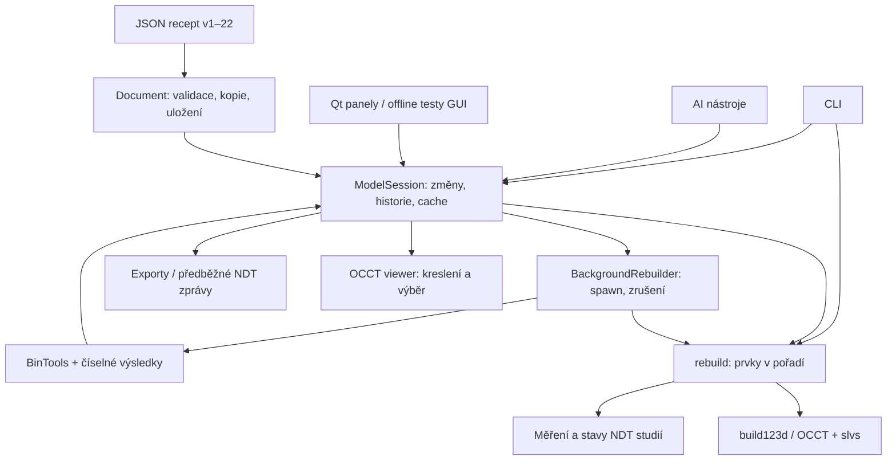

# P0 — audit architektury, rizika a ověření

Výchozí stav: `main` / `94c6e1d0f78f8944f81fd18db28a7ebbe2d18ec7`, 20. 10. 2026.
Rozsah: [roadmapa P0](roadmapa-vyvoje.md#p0--stabilizace-a-prokazatelný-výchozí-stav).
Toto předání mění dokumentaci, testy, měřič a uchování CI evidence. **Nemění `src/`,
závislosti, ukázkové modely, formát 22 ani způsob sestavení aplikace.**

## 1. Skutečná architektura



| Oblast | Skutečné rozhraní a vlastnictví dat | Stávající ochrana |
|---|---|---|
| Recept | `document.py`: `from_dict`, `load`, `save`, `to_dict`, `with_parameters`; verze 1–22, mm | Kontrola struktury, kopie vnořených dat, odmítnutí cizí/verze neznámého formátu. |
| Výrazy a skici | `expressions.py` vlastní AST, `solver.py` slvs, `profile_edit.py`, `projection.py` | Bez `eval`, testy vazeb a profilů; skicář řeší lokálně, worker má vlastní stav. |
| Geometrie | `features.py` registr prvků a `BuildContext.apply`, `rebuild.py` seznam stavů | První chyba zastaví následující prvky; poslední těleso zachová; testy objemů a validity. |
| Reference | `selectors.py`, `picking.py`, `measure.py` | Výběr podle významu, typu, bodu a normály; žádné trvalé indexy ploch. |
| Editace | `session.py`: `_change`, `undo`, `redo`, skupiny změn | Kopie a validace receptu před přijetím; omezená historie; GUI i AI používají session. |
| Asynchronní práce | `worker.py`: `BackgroundRebuilder`, číslované úlohy, `poll`, `cancel`, `encode_result`/`decode_result` | `spawn`, náhradní proces, BinTools pro tvary; testy zrušení a zabití workeru. |
| NDT | `ndt/study.py`, geometrie, UT/pokrytí/objem, PT, MT, RT, plán, audit, návrhy | Otisky receptu/cíle/sondy, výsledky v paměti; návrhy počítají kopie a použití potvrzuje autor. |
| GUI | `gui/main_window.py`, panely a dialogy; `viewer.py` + `viewer_views.py` | Náhradní viewer v offscreen testech, skutečný viewer ve self-testu balíčku. |
| Dodání | dva workflow; PyInstaller spec a samostatná kontrola stažení | Windows DLL kontrola; macOS ditto/ad-hoc podpis; publikace pouze z main. |

Jádro a NDT moduly přímo nezávisí na Qt. Session však kromě přepočtu koordinuje i
geometrii pohledů (řez, cílový objem, mapy); nejedná se o čistě datovou vrstvu.
`worker.py` pro NDT úlohy vytváří vlastní session, takže se tyto vrstvy vzájemně používají.

Velikost důležitých míst na výchozím SHA: `session.py` **4 230 řádků**,
`gui/ndt_panel.py` **2 469**, `gui/main_window.py` **1 928**, `gui/viewer.py` **1 109**,
`cli.py` **1 054**, `features.py` **977**, `worker.py` **420**. To je ukazatel rozsahu
odpovědností, nikoli samo o sobě důkaz vady. P0 moduly plošně nerozděluje.

## 2. Registr rizik a omezení

Priority: vysoká = možnost záměny výsledku nebo ztráty práce; střední = údržba,
výkon či omezená kompatibilita. „Doloženo kódem“ není totéž co reprodukovaná havárie.

| ID / priorita | Nález a důkaz | Ochrana dnes / zbývající mez | Následující krok |
|---|---|---|---|
| R01 / vysoká | `ModelSession.export` kontroluje probíhající úlohu a existenci tělesa, ne `result.ok`. Reprodukce: kvádr 20×30×40, neproveditelné R50 → `ok=False`, přesto STEP 15 408 B a objem 24 000 mm³. | Poslední dobré těleso je zachováno a strom má chybu. Riziko se týká přímého rozhraní session; nelze z toho vyvozovat průchod všemi GUI nabídkami. | P1.4: schválit pravidlo exportu částečného modelu pro GUI/CLI/AI. |
| R02 / vysoká | `BuildContext.apply(add)` nekontroluje souvislost. Reprodukce: kvádr 20×30×40 + oddělený 5×5×10 na X=100 → `ok=True`, 2 solidy, 24 250 mm³. | `is_valid` neznamená jeden solid. Ukázkové díly to testují, obecná smlouva to nezaručuje. | P1.1: rozhodnout podporu více solidů; nezaměňovat ji za sestavy P5. |
| R03 / vysoká | `Document.save` zapisuje přímo `Path.write_text` do cíle (bez atomické výměny). | Neúspěšné Uložit jako zachová session a historii (nový test). Přerušení zápisu existujícího souboru může soubor poškodit; to nový test neřeší a havárie nebyla simulována. | Zvlášť schválit bezpečné ukládání a obnovu; priorita pro další stabilizační krok. |
| R04 / vysoká | `selectors.find_face` volí nejbližší plochu, při shodě normálu; při změně poloměru má fallback na stejný typ. | Významové odkazy a TNP regrese pokrývají běžné změny. Nejde o obecně stabilní identitu při rozdělení/splynutí stejně orientovaných ploch. | P1.3: matice nejednoznačných vazeb před přímými úpravami/importem. |
| R05 / střední | `_run_feature` vrací při výjimce `ctx.part` před operací; nerevertuje celý kontext skic/operací. | Další prvky jsou přeskočené; přenos chyby a posledního solidu testován. Riziko širší transakce při budoucích složených operacích, nikoli doložená ztráta dnešního dílu. | P1.2: přesná transakční smlouva, bez plošného refaktoru v P0. |
| R06 / střední | `parts_before` uchovává tělesa před prvky, historie kopie receptu, worker připravené procesy; velké session/panely. | Omezení historie a rušení existují. Dlouhodobá spotřeba paměti velkých historií není touto baseline pokryta. | P8: oddělit paměť rodiče/workerů a dlouhý opakovaný provoz. |
| R07 / vysoká | NDT reference a studie drží receptové otisky; citlivost kroku, numerické meze a geometrické předpoklady jsou v metodách. | Regrese nejistoty, objemových vah, kolizí a invalidace; upozornění UT/PT/MT/RT. Čísla nejsou fyzická validace ani detekční schopnost. | NDT-17: protokoly s autorem a NDT pracovníkem, zvlášť pro jednotlivé metody. |
| R08 / střední | `pyproject.toml` zamyká hlavní knihovny; dev závislosti mají spodní mez a tranzitivní závislosti nejsou úplně uzamčené. | Baseline zachytí skutečně instalované verze. Stejné SHA nemusí později znamenat stejný environment. | Návrh reprodukovatelnosti před případným novým lockem; P0 závislosti nemění. |
| R09 / střední | Qt testy nahrazují viewer; CI macOS může používat softwarové OpenGL. | Self-test stažených balíčků kontroluje skutečný viewer. To nenahrazuje Retina/trackpad/GPU na autorově Macu a reálné Windows. | P0.6/P7: ruční seznam níže; zaznamenat OS, commit a výsledek. |
| R10 / střední | Starší NDT index a závěr CLAUDE popisovaly PR #29 jako nesloučený. | Git main dokládá sloučení; odkazy/stav opraveny v tomto PR. Starší věty o čekajících ručních testech nepovažovat za aktuální důkaz nefunkčnosti. | Udržovat odděleně „implementováno“, „CI ověřeno“, „ručně přijato“, „odborně validováno“. |
| R11 / střední | Původní test exportů používá glob pro kořen a přímé `ndt/*.json`, nikoli celé rekurzivní pole. | Cílové objemy mají samostatné NDT testy a jsou rekurzivně baleny. Nový P0 test rekurzivně chrání všechny recepty při uložení/načtení. | P3/P4: rozšířit smysluplnou import/export referenční sadu podle rozsahu. |
| R12 / střední | Oddíl README „Formát modelu“ ještě uvádí zápis v21; `Document.VERSION` a pozdější oddíl konstrukčních návrhů uvádějí v22. `assistant._readme_format` tento oddíl používá v pokynu AI. | P0 odkazy přidává mimo tento oddíl, jeho text se proti main nemění. | Samostatně opravit popis a ověřit dopad na AI; nepovažovat to jen za kosmetiku dokumentace. |

**Upřesnění R02 při přípravě P1.1 (20. 10. 2026):** test
`test_sweep_loft.py::test_pattern_repeats_a_sweep` výslovně požaduje 3 solidy.
Více solidů tedy není samo o sobě vada. Autor 20. 10. 2026 schválil
[smlouvu P1.1](p1-1-navrh-smlouvy-geometrickych-operaci.md), která tuto podporu
zachovává a požaduje viditelnost počtu těles i jeho změn. Implementace tohoto
hlášení tehdy nebyla provedena. Schválené P1.2A ji nyní zavádí do společné zprávy
úspěšného 3D prvku i vlastností; podporu více solidů zachovává. [Evidence P1.2A](p1-2a-overeni.md)
uvádí ověření pravidla a viditelnosti počtu těles. R02 se do ručního přijetí autorem
neprohlašuje za uzavřené; historická reprodukce v tabulce zůstává platným záznamem P0.

## 3. Regresní přírůstek P0

Soubor `tests/test_p0_regressions.py`, **32 případů**:

- 26 skutečných receptů z celého `examples/`: načíst → nezávislá kopie → uložit → načíst,
  shoda dokumentu včetně NDT/design a nulová změna původních bajtů; upravený vnořený
  slovník nesmí změnit dokument.
- 2 chybné soubory při otevření rozpracovaného dílu: zachované parametry, cesta,
  výsledek, příznak změn i funkční Zpět/Znovu.
- Odmítnutý výraz při existující větvi Znovu: větev i geometrie zůstanou.
- Neúspěšné Uložit jako: zachování cesty, zdrojového souboru, historie a příznaku změn;
  následný úspěšný zápis uloží skutečný stav.
- Chybný přepočet po serializaci přes BinTools/pickle: česká chyba, přeskočený konec,
  poslední platný solid s analytickým objemem i rozměry. Nejde o další test rychlosti.
- Geometrická chyba → Zpět → Znovu → oprava: správná geometrie a zrušení staré větve Znovu.

Stávající testy už pokrývají zrušení a pád workeru, TNP, neplatné skici, izolaci
konstrukčních variant, invalidaci studií, mapy, GUI a všechny základní exporty.
Tyto testy se neduplikují novou pomalou NDT mapou.

## 4. Opakovatelné měření

```bash
python -m pip install -e ".[dev,gui]"
ruff check src tests
QT_QPA_PLATFORM=offscreen python -m pytest -q --durations=20 --junitxml=out/pytest.xml
python tests/benchmark_p0.py --repeats 3 --output out/p0-baseline.json
```

Ve Windows nastav `QT_QPA_PLATFORM=offscreen` v prostředí (PowerShell:
`$env:QT_QPA_PLATFORM="offscreen"`) a potom spusť tentýž příkaz Pythonu.
Měřič požaduje nový výstupní soubor; již existující nepřepíše.

`tests/benchmark_p0.py` používá existující závislosti a standardní knihovnu. Importy
jsou před měřením, pro každý scénář **1 zahřátí a 3 měřené běhy**, ukládají se
jednotlivé časy, minimum, medián, maximum, vstupní SHA-256, commit, otisk zdrojů,
otisk měřiče, OS, Python, počet logických CPU a instalované knihovny. Jde o měřicí
záznam, **nikoli změnu formátu modelu**. Časy nemají práh úspěchu testu.

| Scénář | Co se měří | Kontrola správnosti |
|---|---|---|
| `priruba.json` | plný přepočet skic, děr a sražení | platné těleso, objem, povrch, rozměry, topologie a stavy |
| `krabicka.json` | parametrický díl s dutinou | totéž; vstupní recept se nesmí změnit |
| `ram.json` | uzavřená trasa tažení | totéž; zachytí jinou cestu jádrem než příruba |
| `ndt/cilove_objemy/tupy_svar_objem.json` | přepočet dílu a stavů objemové studie | totéž; **nepočítá mapu pokrytí** |
| `encode-pickle-decode:priruba` | serializace a deserializace přenosného výsledku v jednom procesu | shodná geometrie/stavy a velikost přenášeného záznamu |
| `ndt:1000-rays-plate` | 1 000 kolmých paprsků přes desku, předem vytvořená PartGeometry | každý jistý, každý 20 mm materiálu podle vzorce |

Paměť je maximum **celého měřicího procesu včetně importů** (`ru_maxrss`, převedeno
na bajty), ne přírůstek scénáře. Windows vrací `null` s vysvětlením. Toto není měření
odezvy okna, startu/spawn, exportu, všech NDT metod ani celkové paměti workerů.
Pro srovnání výkonu použít stejné zařízení, verze, vstupy a zatížení; čísla z různých
OS nebo současně spuštěných testů nejsou vzájemný výkonnostní žebříček.

Oba workflow uchovávají `pytest-results.xml` a `p0-baseline.json` v artefaktech
`p0-checks-windows` / `p0-checks-macos`, i při chybě testů se pokusí nahrát vzniklé
soubory. Samostatná kontrola stažení uchová `self-test.txt` v `p0-self-test-*`.
Retence evidence je 14 dní; důležité porovnání před vypršením uložit. Měřič má
ochranný limit úlohy 3 minuty proti zaseknutí, ne požadavek na rychlost modelování.

## 5. Evidence provedení

- Nezměněný produkční kód main: Ruff prošel; **1 067 testů prošlo za 399,17 s**,
  bez přeskočení. Lokálně macOS arm64, Python 3.12.14, Qt offscreen, izolovaný
  `SKODACAD_HOME`. Celá původní sada zahrnuje testy GUI i pomocných procesů.
- Nové regrese: **32 prošlo** (0,19 s). Konečný celý běh: **1 099 testů prošlo
  za 395,41 s**, bez přeskočení; Ruff a kontrola diffu prošly.
- Stav a logy Windows/macOS pro konkrétní commit jsou v [kontrolách PR #30](https://github.com/JendaNDT/SkodaCAD/pull/30/checks).
  Za úspěch se považují obě úlohy každého systému, včetně self-testu staženého balíčku.
  Souhrn skutečných výsledků je v popisu PR; ruční přijetí to nenahrazuje.
- [Uložená baseline](baselines/p0-macos-arm64.json): 3 opakování po zahřátí,
  spuštěno po skončení původní sady testů. SHA produkčních zdrojů je v záznamu;
  `tracked_changes` transparentně uvádí rozpracovanou dokumentaci/workflow.

| Scénář | Medián (s) | Min–max (s) |
|---|---:|---:|
| `rebuild:priruba.json` | 0.013523 | 0.013458–0.013863 |
| `rebuild:krabicka.json` | 0.027605 | 0.027051–0.027678 |
| `rebuild:ram.json` | 0.133452 | 0.130942–0.133761 |
| `rebuild:ndt/cilove_objemy/tupy_svar_objem.json` | 0.033419 | 0.033116–0.033692 |
| `encode-pickle-decode:priruba` | 0.000926 | 0.000915–0.000928 |
| `ndt:1000-rays-plate` | 0.073680 | 0.071221–0.102704 |

Maximum paměti měřicího procesu: **412.3 MiB**.
Není to paměť celé aplikace ani měření na Windows. Výsledky na jiných strojích
se mohou lišit; změna produkčního výkonu se v tomto PR neočekává.

Ruční a odborné ověření se eviduje samostatně v oddílech níže.

## 6. Ruční postup a evidence autora

**Aktualizace 20. 10. 2026:** autor na Macu Apple M4 / macOS 27.0.1 postupně
potvrdil funkční průchod: spuštění, editace a historie, uložení, chybné zadání
a geometrie, 3D a řez, zastarání studie, náhled/použití varianty, poškozený soubor,
zprávy a nové spuštění. [Protokol](p0-rucni-overeni-macos-2026-10-20.md) uvádí
testované sestavení, původ evidence a samostatně nepotvrzené podbody. Následující
seznam zůstává úplným postupem; potvrzení průchodu neuzavírá širší macOS matici ani NDT-17.

Použít balíček z **tohoto PR** v Actions, až úspěšně projdou obě úlohy příslušného OS.
Odkazy Releases stále ukazují vydání z main. Zapisovat commit, OS, zařízení,
datum a případné snímky/log; kopie ukládat do nové pracovní složky.

1. **Otevření a historie:** otevři ukázku příruby, změň `t` z 18 na 36. Těleso má
   větší tloušťku; Zpět vrátí 18 a Znovu 36. Ulož jako nový soubor a znovu otevři.
2. **Chybná editace:** při rozpracované změně zadej neexistující parametr do výrazu.
   Má přijít česká chyba a předchozí stav zůstane. Neproveditelné sražení `s=50`
   označí chybu ve stromu; Zpět obnoví platný model. Při této chybě neber částečný
   export za hotový díl (R01).
3. **Nedostupný soubor:** zkus otevřít poškozenou kopii JSON. Zpráva musí být
   srozumitelná a rozpracovaný díl zůstat. Vyzkoušej Uložit jako do vlastní nové složky.
4. **3D a řez:** otáčení, zoom, výběr horní plochy, měření, posun řezu, vypnutí řezu.
   Rozměry modelu i uložený recept zůstávají stejné. Na Macu Retina a Shift+tažení,
   na Windows ověř skutečnou myš a velikost okna.
5. **NDT invalidace:** otevři NDT 1 – Deska, změň `t=20` na `30`. Studie se označí
   zastaralá a nevydává se za nové ověření. Zpět vrátí původní recept. Potvrzení studie
   prováděj jen po skutečné kontrole oblasti.
6. **Konstrukční návrh:** otevři NDT 10 – Konstrukční návrh kapsy pro jho,
   NDT → Konstrukční návrh. Nejdřív odhad, potom výpočet; zkus Zastavit. Náhled
   varianty nemění parametry originálu. Podmínku stěny 15 mm ponech; neprošlá varianta
   nesmí jít použít. U prošlé varianty vyzkoušej odmítnutí potvrzení a pak použití
   na pracovní kopii; jediný krok Zpět vrátí původní parametry.
7. **Zprávy a návrat:** exportuj audit/návrh do nové složky; otevři HTML/CSV/PDF,
   zkontroluj češtinu, upozornění, studie a čísla. Zavři aplikaci, znovu otevři kopii
   dílu a ověř uložené zadání. Ručně sleduj, zda nezůstal viset pomocný proces.

Výsledek zapsat např. `commit / OS / krok / očekávání / skutečnost / prošel-neprošel /
příloha`. Úspěšný automatický self-test není náhradou tohoto seznamu.

## 7. NDT-17 — navazující evidence, nikoli hotová validace

| Úroveň | Evidence dnes | Co ještě musí dodat validace |
|---|---|---|
| Analytické geometrie | `test_ndt_geometry`, `test_ndt_ut`, objemové reference a testy metod | vybrat konkrétní deklarované oblasti použití a udržovat případ/algoritmus/toleranci |
| Uživatelský pracovní tok | testy session, GUI, self-test balíčku a [autorem potvrzený průchod na Macu](p0-rucni-overeni-macos-2026-10-20.md) | doplnit výslovně neověřené podbody a ruční Windows matici |
| Fyzický vzorek a zařízení | tento PR nové měření nepřidává | identifikace vzorku/sondy/jha/projekce, původ hodnot, měření a nejistota |
| Odborné přijetí | nesmí být odvozeno z počtu testů | jméno a závěr kvalifikovaného pracovníka pro dohodnutý geometrický rozsah |

NDT-16 zůstává mimo rozsah. Podrobný postup a dokončovací brána NDT-17 jsou
v [roadmapě](roadmapa-vyvoje.md#paralelní-ndt-17--validace-a-meze-použití).
